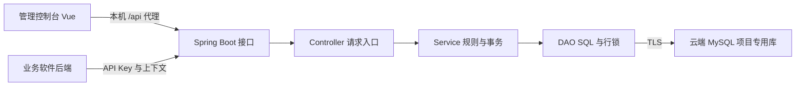

# 项目架构与权限模型

## 总体链路

本机运行前端和后端，数据库使用现有华为云 Swarm 的 MySQL 9.2.0。`127.0.0.1:8080` 是本机后端地址。当前服务绑定 loopback；公开部署需要独立规划 HTTPS 和可信入口，不应直接开放开发服务器。

## RBAC0 与隔离域

隔离域是有序对 `(department_id, application_id)`。

- 用户可以属于多个部门，在每个部门与软件组合中分配多个角色。
- 角色和权限各自只属于一个隔离域，同名或同编码在不同隔离域独立。
- 用户与角色、角色与权限均为多对多，不存在用户直接权限。
- 不引入角色继承、ABAC、职责分离、通配权限、优先级或业务规则。
- 默认激活全部当前已分配角色，也可指定其子集，空子集不激活角色。
- 有效权限是仍分配给该用户且启用的激活角色所关联权限的并集。
- 权限编码是不解析业务含义且区分大小写的标识；resource/action 仅为元数据。
- 多权限校验逐项给出结果，全部通过时才整体允许。

## 部门切换与并发

每个用户只有一个全局当前部门和单调增加的上下文版本，跨软件、跨设备共享。若以后需要按设备独立切换，属于新的模型需求，不能悄悄改变现有语义。

创建不同部门的上下文时，服务锁定用户行，验证成员关系，更新当前部门和版本，删除旧上下文，再创建新 token。切回原部门不会恢复旧 token。同一部门创建其他软件的上下文不改变版本，可并存。

验证请求也锁定同一用户行，因此并发校验与部门切换在该用户上串行化：校验要么在切换前完成，要么看到切换后的失效状态。

## 实时授权与凭据

权限上下文有效期为 1 小时，管理员会话为 8 小时。上下文 token 和 API Key 使用高随机性原始值，库中仅存 SHA-256 哈希；管理员密码使用 BCrypt，cost 为 12。

每次校验实时查询当前角色分配、角色启用状态和权限关联，没有 Redis、跨请求权限缓存或离线 JWT 权限快照。

- 用户编辑、成员关系变更、用户角色重分配及用户停用会使其相关上下文失效。
- 软件停用会删除其上下文。
- 移除角色权限或停用角色，在下一次校验生效。
- 恢复用户或切回部门不会恢复已失效 token。

授权有效性以校验时刻为准。业务软件必须在每次受保护操作前检查，不能缓存已允许结果持续使用。平台不能撤回已经在其他业务系统中执行的操作。

## 信任边界

平台管理员维护组织、身份和全部软件配置，通过密码与管理员会话认证。业务软件通过独立 API Key 认证，软件 ID 从密钥得出，不能由查询参数覆盖。

业务后端只能管理自己软件内的角色、权限、角色权限及用户角色关系；身份和部门成员关系由平台维护。业务后端先完成真实用户认证，再提交可信 externalId。上下文 token 是授权凭据，不是用户登录凭据；API Key 不能下发到普通浏览器。

当前管理员账号用于项目启动与控制台管理，不代表企业 SSO 已接入。

## 数据库与时间

Flyway 管理表结构。正式库固定为 `melonhub_rbac`，测试库固定为 `melonhub_rbac_test`，均在配置的云端入口，TLS 为必需。启动保护在 Flyway 前校验主机、端口、库名和连接选项，不存在本机 MySQL 回退。

复合外键约束用户角色、角色权限两种关联的部门与软件必须一致；服务层也先校验隔离域。角色或权限删除只级联删除相关关联；仍有依赖的部门或软件禁止删除。移除成员关系会级联移除其角色关联。

`audit_events` 记录配置变更及上下文创建/注销，不记录凭据，也不记录每次查询和校验。它是操作审计记录，不是不可变合规日志。

JDBC 使用 `serverTimezone=SERVER` 读取数据库实际会话时区，避免把云端 UTC 误认为上海时区；JSON 展示使用 Asia/Shanghai。该配置不修改 Linux、MySQL 全局时区或其他应用的连接。回归测试同时检查创建时间和 1 小时/8 小时的实际数据库过期差值。

## 工程分层

| 路径 | 职责 |
| --- | --- |
| `backend/src/main/java/com/melonhub/rbac/RbacApplication.java` | Spring Boot 启动入口 |
| `controller/` | HTTP 路由、请求参数和响应 |
| `service/` | 业务规则、事务边界与认证/授权流程 |
| `dao/` | JdbcTemplate、参数绑定 SQL、持久化和数据库锁 |
| `dto/` | 输入类型与 Bean Validation 校验 |
| `security/` | 管理员/API Key 守卫、凭据生成与哈希 |
| `exception/` | 错误类型与统一处理 |
| `config/` | 数据库目标保护、可选演示初始化 |
| `backend/src/main/resources/db/migration/` | Flyway 迁移 |
| `frontend/src/pages/` | 概览、管理页、API 联调 |
| `frontend/src/components/` | 共享界面组件 |
| `scripts/` | 启停、数据库检查和测试脚本 |
| `doc/` | 中文使用说明、接口和架构文档 |

技术栈为 Vue 3、TypeScript、Pinia、Vue Router、Vite，以及 Spring Boot 3.5.7、Spring JDBC、Bean Validation、Flyway 和 MySQL Connector/J。SQL 参数使用绑定，动态表名仅从固定允许集合选择。Controller 和 Service 不直接使用 JdbcTemplate。

## 验证范围与限制

2026-10-18 在云端专用测试库通过 16 项集成测试和 9 项测试目标保护测试，共 25 项，零失败、零错误、零跳过。集成测试业务数据通过事务回滚。正式库还通过浏览器新增、关联分配、权限校验、部门切换、页面刷新及直接 TLS SQL 回读验证，临时业务数据随后清理。

当前 Flyway 对 MySQL 9.2 仍提示超出其已测试版本范围；本项目已验证的迁移和用例成功，不等于全部版本兼容性均已证明。

操作流程见 [项目使用说明书](使用说明书.md)，请求协议见 [业务 API](API.md)。
