# MelonHub 后端 UML 与代码导读

代码基线为当前 RBAC1 实现提交 `99dfa84`。后端启动时用 `melonhub.backend-strategy=structured|ddd` 选择实现，默认 `structured`。两种策略共享控制器、用例接口和数据库结构。本页选择同一组 API 对照两种设计，便于从图定位到代码。

## 1. 包依赖

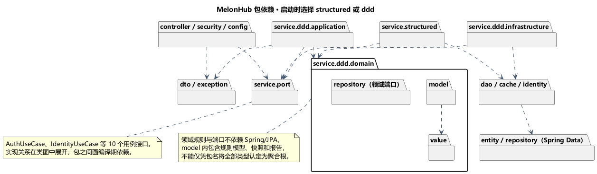

[SVG](uml/packages.svg) · [PlantUML 图源](uml/packages.puml)

箭头表示主要源码依赖，不表示 HTTP 请求或调用时序；图按职责合并了部分包。`controller/security/config` 经 `service.port` 使用用例；结构化实现直接使用 DAO 等共享设施；DDD 应用服务经领域仓储和网关端口使用基础设施适配器。领域层不依赖 Spring/JPA。应用层仍使用共享 DTO、管理员身份及范围契约，例如 `DddBoundary` 将 `dao.Visibility` 转为领域 `DomainVisibility`；这与直接调用 DAO 查询不同。两套策略不是两个独立部署的微服务。

边界检查见 [ArchitectureBoundaryUnitTest](../backend/src/test/java/com/melonhub/rbac/requirements/nfr_reliability/ArchitectureBoundaryUnitTest.java)，启动装配见 [BackendStrategyWiringUnitTest](../backend/src/test/java/com/melonhub/rbac/requirements/nfr_reliability/BackendStrategyWiringUnitTest.java)。包与职责清单见 [架构说明](ARCHITECTURE.md#10-工程分层与双策略后端structured--ddd)。

## 2. API 权限查询

`GET /auth/api-permissions/{operationId}`：认证 JWT 和活动会话，查询操作映射，再判断当前用户是否具有对应权限。已登记操作返回 `{operationId, allowed}`；未登记返回 `404 API_OPERATION_NOT_FOUND`；认证失败返回 `401`。

这是 MelonHub 提供的接口，可用于比较设计。当前老师课程后端实际通过 `/auth/me` 获取权限集合，不能把本接口时序图称作课程系统实际请求链路，证据见 [课程权限接入核对](课程权限接入核对.md)。

### 2.1 结构化实现

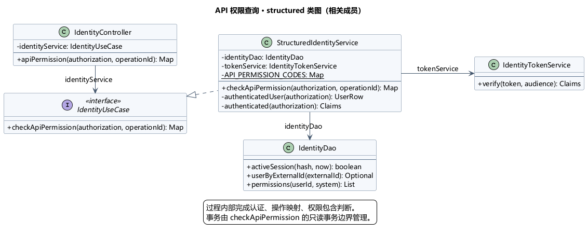

[SVG](uml/api-permission-class.svg) · [图源](uml/api-permission-class.puml)

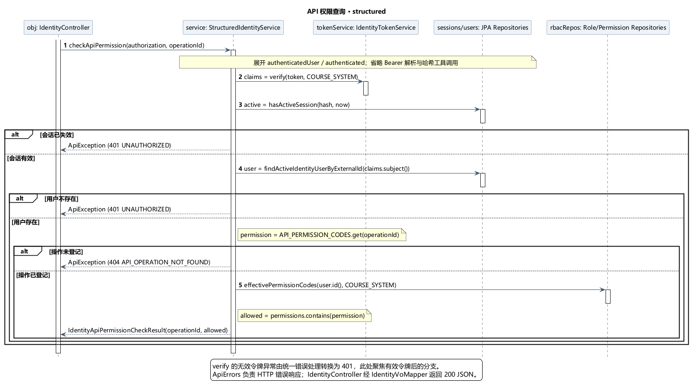

[SVG](uml/api-permission-sequence.svg) · [图源](uml/api-permission-sequence.puml)

代码阅读顺序：

1. [IdentityController.apiPermission](../backend/src/main/java/com/melonhub/rbac/controller/IdentityController.java) 接收 HTTP 参数并委托 [IdentityUseCase](../backend/src/main/java/com/melonhub/rbac/service/port/IdentityUseCase.java)。
2. [StructuredIdentityService.checkApiPermission](../backend/src/main/java/com/melonhub/rbac/service/structured/StructuredIdentityService.java) 调用 `authenticatedUser`；辅助方法展开了令牌校验和会话、用户读取。
3. 同一服务用 `API_PERMISSION_CODES.get(operationId)` 取映射，通过 [IdentityDao.permissions](../backend/src/main/java/com/melonhub/rbac/dao/IdentityDao.java) 查询权限并做 `contains` 判断。

图聚焦有效令牌之后的会话、用户、操作映射分支；Bearer 格式、哈希工具和 JWT 内部算法不展开。类图只展示相关成员。

### 2.2 DDD 实现

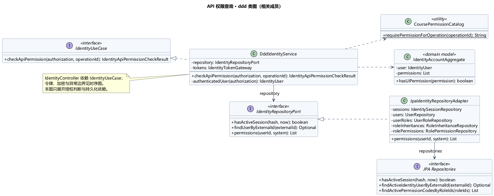

[SVG](uml/api-permission-ddd-class.svg) · [图源](uml/api-permission-ddd-class.puml)

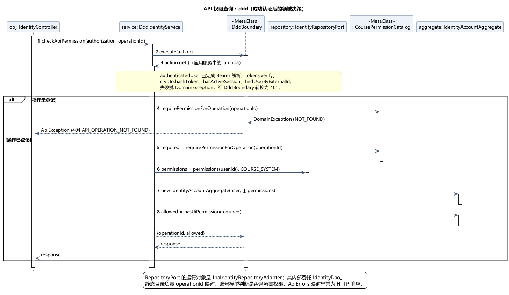

[SVG](uml/api-permission-ddd-sequence.svg) · [图源](uml/api-permission-ddd-sequence.puml)

代码阅读顺序：

1. [DddIdentityService.checkApiPermission](../backend/src/main/java/com/melonhub/rbac/service/ddd/application/DddIdentityService.java) 仍承担只读事务和流程协调，`authenticatedUser` 经仓储/加密网关读取身份。
2. 静态目录 [CoursePermissionCatalog.requirePermissionForOperation](../backend/src/main/java/com/melonhub/rbac/service/ddd/domain/value/CoursePermissionCatalog.java) 决定操作对应权限；[IdentityAccountAggregate.hasUiPermission](../backend/src/main/java/com/melonhub/rbac/service/ddd/domain/model/IdentityAccountAggregate.java) 根据账号权限快照判断。
3. [IdentityRepositoryPort](../backend/src/main/java/com/melonhub/rbac/service/ddd/domain/repository/IdentityRepositoryPort.java) 的实际实现是 [JpaIdentityRepositoryAdapter](../backend/src/main/java/com/melonhub/rbac/service/ddd/infrastructure/JpaIdentityRepositoryAdapter.java)，内部委托共享 `IdentityDao`。
4. [DddBoundary.execute](../backend/src/main/java/com/melonhub/rbac/service/ddd/application/DddBoundary.java) 捕获 `DomainException` 并调用 [ApiErrors](../backend/src/main/java/com/melonhub/rbac/exception/ApiErrors.java) 转为 `ApiException`。

时序图省略认证成功路径的展开，重点展示领域判断与异常转换。`action.get()` 表示服务方法内传给 `DddBoundary` 的 Supplier lambda，不是服务类声明的新公开方法。

## 3. 创建分级管理员

`POST /api/admin/accounts`：控制器先经过功能鉴权与参数校验，服务在事务内锁定管理员账号行，读取层级和角色功能，校验候选节点，保存账号及范围并审计。非法候选层级返回 `409 CONFLICT`；正常返回 `200 {id, username}`。缺权限、非法参数等前置错误另有 `403/400`，不应统称 409。

### 3.1 结构化实现

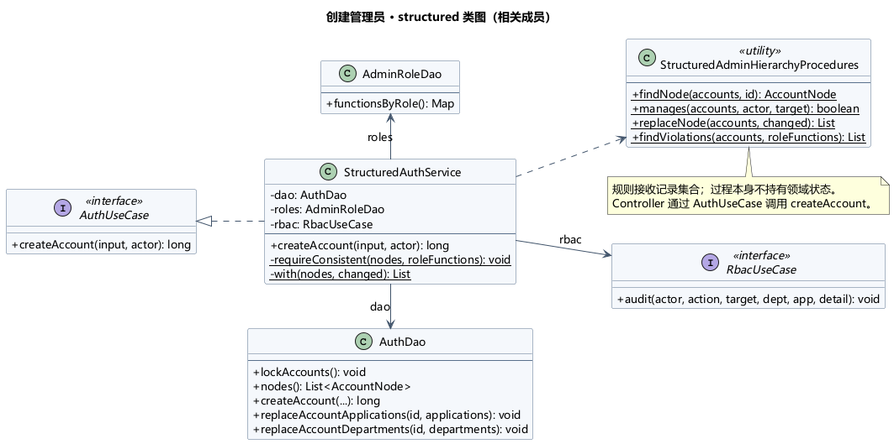

[SVG](uml/admin-account-class.svg) · [图源](uml/admin-account-class.puml)

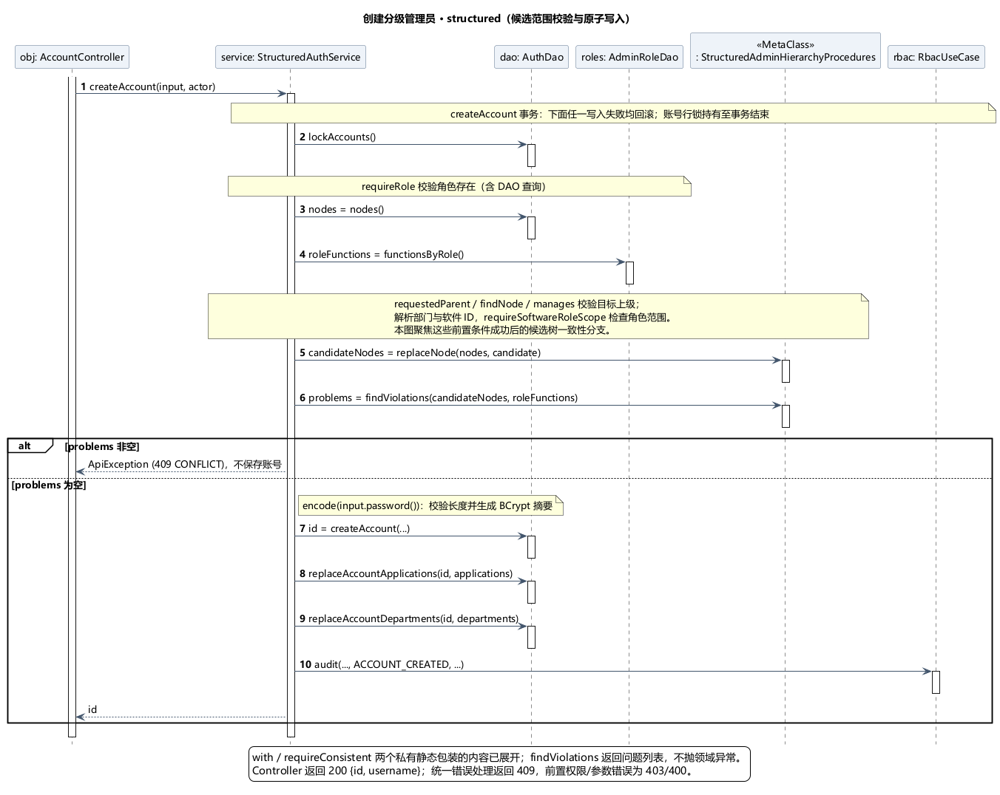

[SVG](uml/admin-account-sequence.svg) · [图源](uml/admin-account-sequence.puml)

[AccountController.create](../backend/src/main/java/com/melonhub/rbac/controller/AccountController.java) 经 [AuthUseCase](../backend/src/main/java/com/melonhub/rbac/service/port/AuthUseCase.java) 调用 [StructuredAuthService.createAccount](../backend/src/main/java/com/melonhub/rbac/service/structured/StructuredAuthService.java)。服务协调 [AuthDao](../backend/src/main/java/com/melonhub/rbac/dao/AuthDao.java) 加锁/读写，以及 [AdminRoleDao](../backend/src/main/java/com/melonhub/rbac/dao/AdminRoleDao.java) 读取功能。私有 `with`/`requireConsistent` 调用静态过程集 [StructuredAdminHierarchyProcedures.replaceNode/findViolations](../backend/src/main/java/com/melonhub/rbac/service/structured/StructuredAdminHierarchyProcedures.java)，把数据作为参数传入规则过程。

### 3.2 DDD 实现

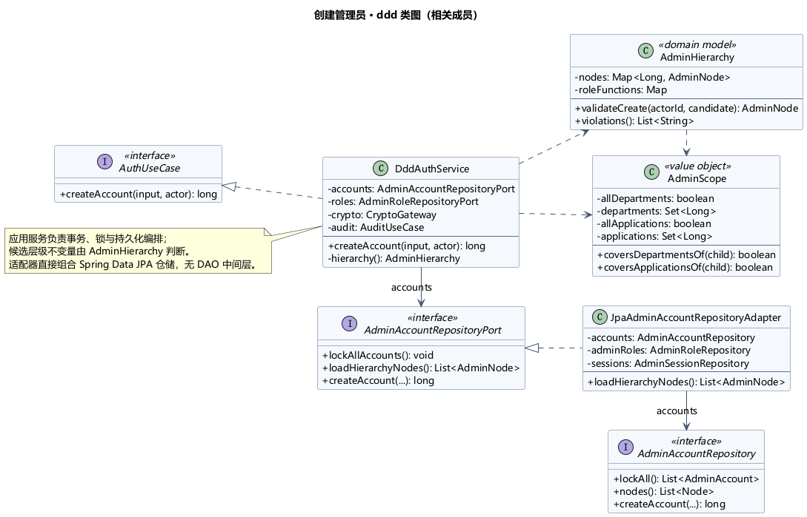

[SVG](uml/admin-account-ddd-class.svg) · [图源](uml/admin-account-ddd-class.puml)

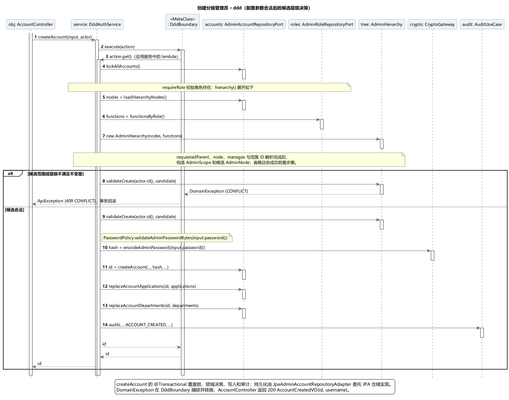

[SVG](uml/admin-account-ddd-sequence.svg) · [图源](uml/admin-account-ddd-sequence.puml)

[DddAuthService.createAccount](../backend/src/main/java/com/melonhub/rbac/service/ddd/application/DddAuthService.java) 经 [AdminAccountRepositoryPort](../backend/src/main/java/com/melonhub/rbac/service/ddd/domain/repository/AdminAccountRepositoryPort.java) 加锁并加载节点，结合角色功能构造 [AdminHierarchy](../backend/src/main/java/com/melonhub/rbac/service/ddd/domain/model/AdminHierarchy.java)。候选节点包含不可变范围 [AdminScope](../backend/src/main/java/com/melonhub/rbac/service/ddd/domain/value/AdminScope.java)，由 `tree.validateCreate` 判断层级一致性。存储实现为 [JpaAdminAccountRepositoryAdapter](../backend/src/main/java/com/melonhub/rbac/service/ddd/infrastructure/JpaAdminAccountRepositoryAdapter.java)。

两幅时序图都聚焦前置角色、目标上级和范围解析成功后的候选一致性分支；省略的前置步骤在图内注明。模型负责规则，事务与数据库锁仍由应用服务和基础设施保障，不能声称领域对象独自保证并发一致性。GRASP 与概念边界见 [面向对象设计答辩](面向对象设计答辩.md)。


## 4. RBAC1 角色继承

角色继承属于业务角色授权模型。当前规则定义为子角色继承父角色的权限，继承关系限定在同一部门 × 软件隔离域内。用户分配子角色后，权限上下文、统一身份权限查询、权限反查和模拟结果沿父角色链展开并去重。循环继承和跨域继承在应用层拒绝，V17 的复合外键负责数据库域一致性。

### 4.1 structured 实现

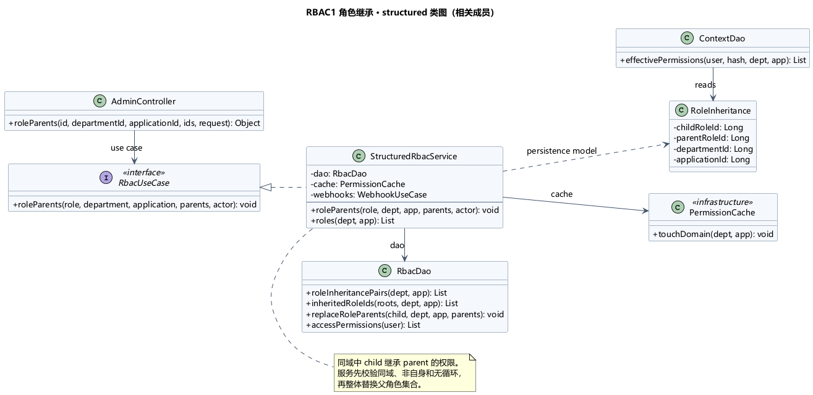

[SVG](uml/role-hierarchy-class.svg) · [图源](uml/role-hierarchy-class.puml)

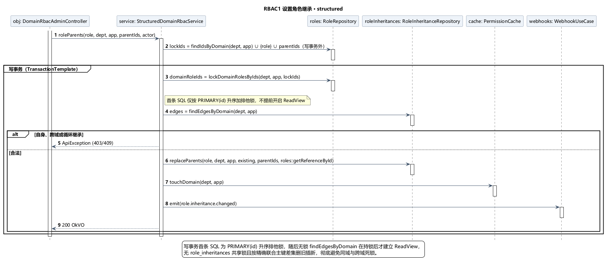

[SVG](uml/role-hierarchy-sequence.svg) · [图源](uml/role-hierarchy-sequence.puml)

[StructuredRbacService.roleParents](../backend/src/main/java/com/melonhub/rbac/service/structured/StructuredRbacService.java) 校验父角色属于当前域，并用 `RbacDao.inheritedRoleIds` 检测循环，再整体替换 `role_inheritances`。上下文读取由 [ContextDao](../backend/src/main/java/com/melonhub/rbac/dao/ContextDao.java) 展开继承链。

### 4.2 DDD 实现

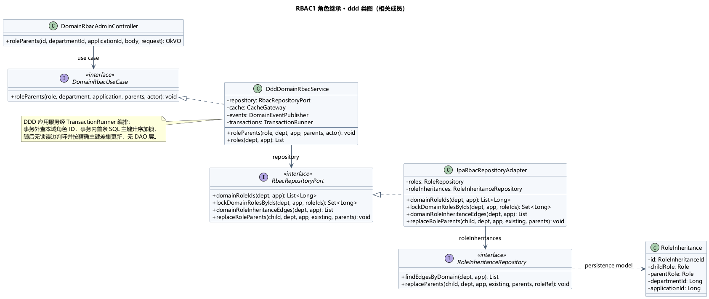

[SVG](uml/role-hierarchy-ddd-class.svg) · [图源](uml/role-hierarchy-ddd-class.puml)

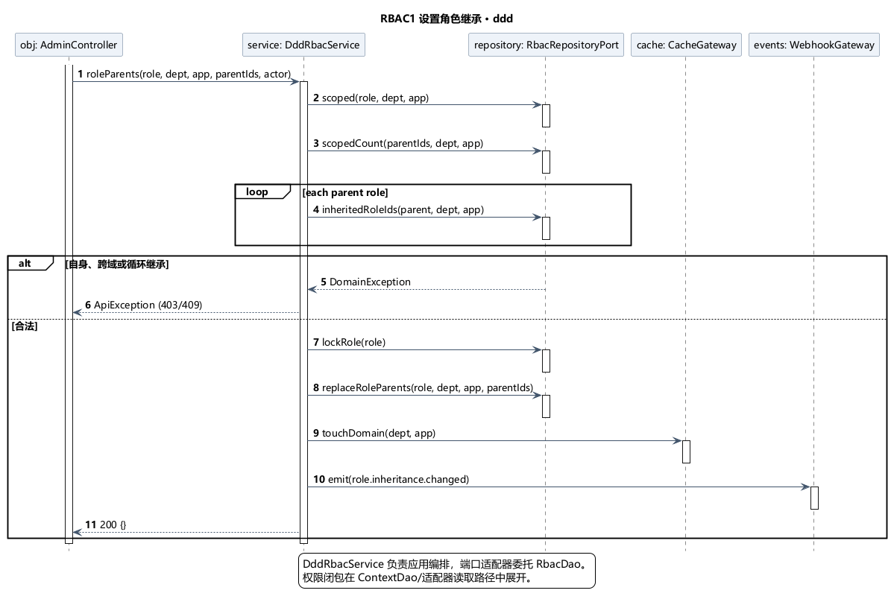

[SVG](uml/role-hierarchy-ddd-sequence.svg) · [图源](uml/role-hierarchy-ddd-sequence.puml)

[DddRbacService.roleParents](../backend/src/main/java/com/melonhub/rbac/service/ddd/application/DddRbacService.java) 通过 [RbacRepositoryPort](../backend/src/main/java/com/melonhub/rbac/service/ddd/domain/repository/RbacRepositoryPort.java) 访问继承关系。当前 DDD 代码把角色层级校验和事务编排放在应用服务，端口适配器委托 `RbacDao`；权限闭包在权限上下文仓储读取路径中展开。图中没有虚构独立的领域聚合。

## 5. 重新生成

十三份 `.puml` 是图源，每份同时输出 PNG 与 SVG。安装 Java 并准备 PlantUML JAR 后，在仓库根目录执行：

```powershell
./scripts/render-uml.ps1 -PlantUmlJar '<已有 PlantUML JAR 的绝对路径>'
```

也可设置 `PLANTUML_JAR` 后直接运行脚本。图使用 Microsoft YaHei；导出后需打开 PNG 核对字体、连线、执行条与布局。生成器见 [render-uml.ps1](../scripts/render-uml.ps1)。
