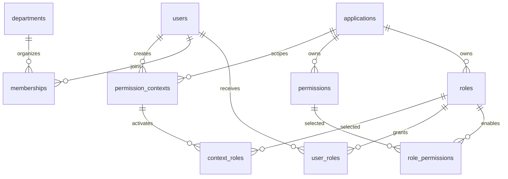

# 数据库设计

更新日期：2026-10-20。本文描述 Flyway V6 后的结构；V1–V5 保留历史，不修改已应用迁移。

## 授权模型

隔离边界为 **软件**：软件拥有角色与权限，同一软件内多个角色可以共享权限。部门仅管理成员、筛选人员和批量设置软件角色，不参与授权判断。用户可以没有部门，也可属于多个部门。

- 角色编码在软件内唯一：`UNIQUE(application_id, code)`。
- 权限编码在软件内唯一：`UNIQUE(application_id, code)`。
- 用户可以被分配多个软件的多个角色；没有用户直接权限、角色继承或部门授权。
- `role_permissions` 记录角色与权限的多对多关系，只能关联同一软件中的角色与权限。
- 校验结果为该软件中已激活、已分配、启用且未到期角色的权限编码并集。相同编码去重；resource/action 仅是元数据。



## 核心表与约束

| 表 | 主要字段 | 主键、唯一键与外键 |
| --- | --- | --- |
| applications | id、name、code、enabled、rate_limit | id 主键；code 唯一；软件是授权隔离边界 |
| roles | id、application_id、name、code、description、enabled | id 主键；(application_id,code) 唯一；(id,application_id) 复合唯一；软件外键 |
| permissions | id、application_id、name、code、resource、action | id 主键；(application_id,code) 唯一；(id,application_id) 复合唯一；软件外键 |
| role_permissions | role_id、permission_id、application_id | (role_id,permission_id) 主键；两个复合外键分别验证角色、权限的软件，删除所属对象时级联 |
| users | id、external_id、name、email、enabled、context_version | id 主键；external_id 唯一；不保存当前部门 |
| memberships | user_id、department_id | 联合主键；只表达组织成员关系，移出部门不删除软件角色 |
| user_roles | user_id、role_id、application_id、expires_at、granted_by、granted_at、grant_id | (user_id,role_id) 主键；独立用户外键；(role_id,application_id) 复合外键 |
| permission_contexts | id、user_id、application_id、context_version、expires_at | id 为 token 的 SHA-256；用户/软件外键；上下文有效期一小时 |
| context_roles | context_id、role_id | 联合主键；上下文和角色外键，均级联删除 |

编码区分大小写。后端事务检查所属关系，数据库复合外键再次拒绝跨软件角色分配与角色权限关联。

`expires_at=NULL` 表示永久；到期即不计入权限，无需等待清理任务。每次重新授予或变更期限生成新的 `grant_id`，复核仅能撤销快照中的那次分配。批量追加保留已有有效角色及期限。

## 治理与安全表

| 表 | 职责 |
| --- | --- |
| application_keys | 软件 API Key 哈希、前缀、有效期与吊销；每软件最多十个有效密钥 |
| admin_accounts、admin_sessions | 管理员角色、密码哈希、MFA、锁定、会话及 credential_version |
| admin_account_applications | 软件管理员可管理的软件集合 |
| access_requests | 申请、审批、期限及名称快照；同用户同角色待审批唯一；无部门仍可审批 |
| access_reviews、access_review_items | 软件复核，可按当前部门成员筛选；保存 grant_id、名称快照与决定 |
| webhooks、webhook_deliveries | 软件通知、签名密钥与事务外盒、租约、重试状态 |
| audit_events、audit_seal | 审计详情、封存序号、哈希链及保留期锚点 |

API Key、上下文 token、管理员会话仅保存 SHA-256；管理员密码使用 BCrypt。敏感配置、Webhook/TOTP 密钥不写入文档、示例和日志。

## V6 升级策略

1. 备份授权数据，停止旧版本写入；新程序通过 Flyway 执行 `V6__application_scope.sql`。
2. 同一软件同编码权限归并为最小 ID 的定义，更新角色关联；每个角色的权限编码集合保持不变，未关联的权限不会产生授权。
3. 同软件内原来分属不同部门的同编码角色保持独立；最小 ID 保留编码，其余使用截短原编码、`:legacy:` 和随机 UUID 生成唯一编码。角色 ID、分配、期限与 grant_id 均保留。
4. 删除角色、权限、角色权限关联、用户角色和上下文中的部门字段，以及 users.active_department_id；治理和审计保留历史部门快照。
5. 清除旧上下文，业务侧重新获取 token。缓存元数据使用 `ctx:v2:`，避免命中旧模型。

本分支按用户确认保留软件内共享权限，与上游另一条历史中的 `V6__role_owned_permissions.sql` 不兼容。**已执行该另一份 V6 的数据库不能直接升级到本分支**；需要单独设计并验证数据转换迁移。不要同时放入两个 V6，也不要用 Flyway repair、更改校验和或删除历史记录来跳过结构差异。本分支支持从 V1–V5 升级，或继续使用已经应用本分支 V6 的数据库。

MySQL DDL 不能整体事务回滚；升级前保留数据库备份。失败时先确认 Flyway 记录和实际结构，不直接删除历史或重新初始化。角色统一到软件后，原有分配作为软件角色保留；上线前应复核是否仍需这些授权。

## 上下文与数据源

部门变化不使软件上下文失效。修改用户身份、停用用户、强制下线撤销用户上下文；重新分配、审批或复核回收撤销该用户在该软件的上下文。角色启停和权限变更在下一次校验生效。

MySQL 为唯一持久数据源，正式库固定为 `melonhub_rbac`、测试库固定为 `melonhub_rbac_test`，连接强制 TLS。保留 cloud/local 两种显式运行配置，本地模式仅接受回环地址；不会在入口失败时自动切换。Redis 使用项目专用实例，`CACHE_ENABLED=false` 可关闭缓存。缓存沿用用户/软件/密钥代标记与 epoch 协议，到期缓存受最早分配到期时间限制。运行细节见[本地 Docker 运行](本地Docker运行.md)和[云数据库运行](云数据库运行.md)。

## 清单格式

软件级 `version:2` 不包含部门：

```json
{
  "version": 2,
  "permissions": [
    {"code":"item:read","name":"读取","resource":"item","action":"read"}
  ],
  "roles": [
    {"code":"reader","name":"阅读者","description":"","enabled":true,"permissions":["item:read"]}
  ]
}
```

导入按软件内角色编码和权限编码匹配，更新列出的角色配置；多个角色可引用同一个权限编码，用户分配和期限不变。旧 v1 清单不能直接导入，应升级后重新导出或人工转换并复核。
