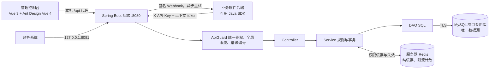

# 项目架构与权限模型

## 1. 总体链路

当前 Java 后端在服务器独立容器运行，API 发布到服务器回环 18080；本机前端经本机 8080 的 SSH 通道访问。BACKEND_MODE=local 保留本机 Java 调试。只连接云 MySQL，服务器 Redis 待部署且默认关闭；运行方式见[服务器部署与启动](服务器部署与启动.md)。

MySQL 是唯一数据源。Redis 只缓存可以随时从 MySQL 重新算出的授权结果，以及可以丢失的限流计数，不保存任何只存在于 Redis 的状态，没有持久化，清空或宕机都不会丢数据。

## 2. 角色与软件

软件隔离角色和权限；部门仅管理成员和批量设置软件角色。角色编码和权限编码分别在软件内唯一。角色可共享同一权限定义。用户多角色，角色可从软件权限池选择权限子集；有效权限为已激活、已分配、启用、未到期角色的权限编码并集。无用户直接权限、继承、ABAC 或通配规则。

数据库用复合外键验证角色和权限属于同一软件，允许同软件跨角色共享权限。移出部门不会删除软件角色；部门删除只检查成员，软件删除仍检查角色、权限依赖。完整结构与 V7 迁移策略见 [数据库设计](数据库设计.md)。

## 3. 上下文

创建上下文时锁用户，验证用户和软件启用、激活角色为已分配有效角色的子集；部门可省略或传 0，不要求部门成员。旧 departmentId/switchDepartment 保留兼容，不再切换全局部门或撤销其他上下文。

校验不加锁，在事务快照中验证用户、软件、版本和期限，再读取角色权限。变更提交后开始的校验看到新状态；与提交并发的校验可能看到旧结果。

| 变更 | 影响 |
| --- | --- |
| 部门变化、移出部门、删除无成员部门 | 软件角色和上下文保留 |
| 修改外部标识、停用/删除用户、强制下线 | 用户上下文失效 |
| 重新分配、角色成员变更、批准申请、复核回收 | 对应用户在该软件的上下文失效 |
| 停用/删除软件 | 该软件上下文失效 |
| 角色启停、权限变更、清单导入 | 下一次校验生效 |
| 分配到期 | 到期角色立即不计入，上下文仍有效 |
| 恢复启用 | 不恢复已撤销 token |

## 4. 权限缓存（Redis）

### 4.1 缓存内容

| 键 | 内容 | 有效期 |
| --- | --- | --- |
| `ctx:{token 哈希}` | 上下文元数据：用户、部门、软件、版本、到期时间（创建后不变） | 上下文剩余寿命 |
| `eff:{token 哈希}:{纪元}:{用户代}:{软件代}:{域代}` | 校验结果：是否有效、有效角色、有效权限、最早到期时刻 | 最长 60 秒，且不超过其中最早到期的角色分配 |
| `key:{API Key 哈希}` | 密钥所属软件和密钥 ID（不变） | 1 天 |
| `kst:{API Key 哈希}:{纪元}:{密钥代}` | 密钥状态：是否有效、过期时间 | 最长 60 秒 |
| `gen:u:{用户}`、`gen:a:{软件}`、`gen:k:{软件}`、`gen:d:{部门}:{软件}` | 随机“代”标记及其 `:busy` 计数 | 1 天 / 120 秒 |
| `epoch` | 全局纪元 | 永久，仅递增 |
| `rl:login:{来源地址}:{窗口}`、`rl:app:{软件}:{窗口}` | 全局限流计数（第 5 节） | 窗口长度 + 1 秒 |

所有键带 `melonhub-role-v2:` 前缀。一次校验在 Redis 中执行一个 Lua 脚本，原子地读取相关代标记、忙碌计数和结果。键名在脚本内拼接，因此要求单节点 Redis，不支持 Redis Cluster。

### 4.2 失效协议

改变授权状态的写操作在数据库提交前替换相关代标记并增加其忙碌计数，提交后再次替换代标记，事务结束时减少忙碌计数。读取方在查询 MySQL 之前先原子读取代标记和忙碌标志：忙碌时只查询不回写；不忙时把结果写入由读取时的代标记组成的键。

因此提交前读到的旧快照只会写在旧代的键下，提交后任何读取都会计算出新键，不会读到旧结果。

| 写操作 | 替换的代标记 |
| --- | --- |
| 用户编辑、启停、删除、强制下线、角色重分配（含带有效期的分配），上下文注销 | 用户代 |
| 批准角色申请、关闭权限复核（对每个被回收的用户） | 用户代 |
| 软件启停、删除 | 软件代与密钥代 |
| 新建、吊销、紧急轮换 API Key | 密钥代 |
| 角色编辑、启停、删除，权限编辑、删除，角色权限调整，角色成员调整，导入权限清单 | 软件代 |

新建角色或权限不影响任何已有上下文的结果，因此不替换代标记。批量导入用户只新建或更新用户资料并补充成员关系，不改变已有上下文的校验结果，也不替换代标记。

角色分配到期不是写操作，到期那一刻没有人替换代标记。因此校验结果在计算时记下其中最早到期的角色分配时刻：缓存有效期不超过该时刻，命中时如已过该时刻也会重新查询 MySQL。后台每分钟删除已到期的分配行，替换用户代，并发出 `user.roles.expired` 事件和 `USER_ROLES_EXPIRED` 审计；多个实例同时运行时，按主键条件删除保证每条到期只通知一次。

### 4.3 故障与恢复

- 任一 Redis 调用失败（超时 300 毫秒）会打开 5 秒熔断，期间本实例所有校验直接查询 MySQL，之后自动重试。
- 写操作如果因 Redis 不可用而无法在提交前标记，仍然正常提交，同时记为“遗漏的失效”。本实例在推进全局纪元之前一直绕过 Redis；Redis 恢复后，后台任务每 2 秒检查一次并推进纪元，所有实例的旧缓存随即作废。
- 只有“写入实例连不上 Redis、其他实例还连得上”这种部分故障时，其他实例才可能在纪元推进前继续使用旧结果，最长不超过结果的 60 秒有效期。
- 健康接口中 `cache` 的取值：`UP` 正常；`RECOVERING` 已连通但尚未完成纪元推进，期间仍走 MySQL；`DOWN` 不可用；`DISABLED` 已在配置中关闭。缓存状态不影响健康接口的 HTTP 状态码。

Redis 将部署在服务器。当前 CACHE_ENABLED=false，客户端能力保留，启停脚本不管理 Redis。启用后需配置服务器地址、认证及网络；缓存可清空，MySQL 为唯一数据源。

## 5. 高峰保护与容量

| 措施 | 当前配置 | 作用 |
| --- | --- | --- |
| 权限缓存 | 见第 4 节 | 重复校验不访问 MySQL，校验路径不加锁 |
| 按软件限流 | 默认每软件每秒 1000 次（`APP_RATE_LIMIT`），可按软件单独设置；Redis 固定 1 秒窗口，跨实例共享 | 单个异常软件不会拖垮共享数据库，超限返回 429 + `Retry-After` |
| 登录限流 | 每来源地址每分钟 10 次，跨实例共享 | 抵御密码爆破 |
| 连接池快速失败 | Hikari 最多 20 条（`DB_POOL_SIZE`），获取等待 2 秒 | 过载时返回 503 + `Retry-After`，不让请求无限排队 |
| 行锁等待上限 | 会话级 `innodb_lock_wait_timeout=5` 秒 | 热点用户行不会长时间占用请求线程 |
| 事务超时 | 30 秒 | 防止长事务拖住连接 |
| Tomcat | 最多 200 线程（`HTTP_MAX_THREADS`），队列 200，最大连接 8192 | 限制并发，排队有上限 |
| 优雅停机 | 最长等待 20 秒 | 停止时完成在途请求 |
| API Key 最近使用时间 | 内存汇总，每 60 秒批量写一次 | 校验路径不写数据库 |

全局限流（`GlobalRateLimiter`）在 Redis 中用一个 Lua 脚本对 `rl:` 键执行 INCR 并在首次计数时设置过期，计数超过上限即拒绝。`GLOBAL_RATE_LIMIT=false`、`CACHE_ENABLED=false` 或某次 Redis 调用失败时，自动退回本实例内存中的令牌桶（每秒补充额度等于上限，容量也等于上限），此时多实例的额度按实例分别生效。Redis 调用失败会让限流器打开独立的 5 秒熔断，期间不再尝试 Redis，避免故障时每个请求都等待 Redis 超时。单个软件的限额保存在 `applications.rate_limit`（空值为平台默认，0 为不限制），每个实例缓存 30 秒（`ApplicationRateLimits`）。

后端实例本身不保存会话或授权状态：管理员会话和上下文在 MySQL，缓存与限流计数在共享 Redis，多个实例可以并列部署在负载均衡之后。API Key 使用时间按实例在内存中汇总。

写路径的行锁顺序统一为“用户 → 角色 → 角色分配”：按用户调整角色时先锁用户行，再锁该用户的分配；整体替换角色成员时先按 ID 顺序锁住全部相关用户，再锁角色和它的分配。替换角色成员时，“相关用户”来自一次不加锁的读取，若随后的加锁读取发现有人在这之间加入了该角色，本次尝试整体回滚（释放全部锁），下一次把这些用户放在最前面加锁，最多 3 次，仍冲突返回 503。这样不会在持有角色锁之后再去锁用户，避免与并发的按用户调整形成死锁。新建 API Key 时锁定软件行，保证每个软件最多 10 个有效密钥在并发下也成立。

2026-10-18 在本机（Docker Desktop 上的 MySQL 与 Redis）实测，详见 [验证记录](验证记录.md)。以下压测数字来自上一轮（按实例令牌桶限流时），本轮引入全局限流后没有重新压测：

- 关闭限流的单实例，3 个压测客户端合计约 3584 次校验/秒，全部成功；服务端平均每请求约 3.0 毫秒，其中约 2.3 毫秒花在两次 Redis 往返上，数据库连接只被使用 176 次。此时瓶颈在压测客户端和 Docker Desktop 的网络转发，不在服务端。
- 默认限流下，16–128 并发总请求约 1800–1900 次/秒，其中约 1315 次/秒成功，其余被限流返回 429，限流按预期生效。
- Redis 停止期间，64 并发全部成功，约 661 次/秒，中位延迟约 85 毫秒；Redis 恢复后回到约 1810 次/秒。

这些数字说明数量级，不是生产容量承诺。生产环境的 Redis 与应用同机或同机房部署时，往返时间通常明显小于 Docker Desktop。全局限流每次业务请求会多一次 Redis 往返。

## 6. 平台管理员

| 角色 | 能力 |
| --- | --- |
| 超级管理员 `SUPER_ADMIN` | 全部能力，并管理平台管理员账号（含解锁、重置两步验证） |
| 平台管理员 `ADMIN` | 读写部门、用户（含批量导入）、软件（含限流）、全部授权域、API Key 和 Webhook |
| 软件管理员 `APP_ADMIN` | 只读平台数据；只看到并管理被授权软件的授权域、审批、复核、清单、API Key 和 Webhook |
| 审计员 `AUDITOR` | 全部只读，可导出审计、校验审计链 |

每个控制台接口都在处理函数内重新确认调用者身份和角色，即使请求绕过了统一过滤器也会拒绝。

- `.env` 的 `ADMIN_USERNAME` / `ADMIN_PASSWORD` 只在账号不存在时创建初始超级管理员。之后在控制台改密码；忘记密码时把 `ADMIN_PASSWORD_RESET` 设为 true 重启一次，恢复后改回 false。
- 密码为 12–100 个字符，且 UTF-8 编码不超过 72 字节（BCrypt 只使用前 72 字节，超长密码被拒绝而不是截断），以 BCrypt（cost 12）保存。不存在的账号也执行一次 BCrypt 比较，避免通过响应时间判断账号是否存在。`.env` 中的初始管理员密码超过 72 字节时拒绝启动。
- 连续 5 次密码或动态口令错误锁定 15 分钟；会话最长 8 小时，空闲 30 分钟失效。修改密码会让该账号的其他会话下线；重置密码、修改角色或停用会让该账号全部会话下线。
- 凭据版本（`admin_accounts.credential_version`，V5）：上述操作都会递增版本，会话行记录创建时的版本，只有版本一致的会话才能通过鉴权。登录在校验密码之后，用一条条件插入创建会话：要求账号仍启用、凭据版本、密码哈希和两步验证密钥都与校验时读到的相同，否则不插入并返回 401。因此与改密、重置、改角色、停用、两步验证变更并发的登录不会留下可用会话。删除账号会级联删除其会话；同名重建的账号凭据版本从 0 开始，但新密码哈希的盐不同，校验旧账号得到的结果不能为新账号创建会话。
- 可选的两步验证（`Totp`，RFC 6238，HMAC-SHA1、30 秒、6 位，容忍前后一个步长）：先生成待绑定密钥，用第一个有效口令确认后才生效；登录成功会记录所用时间步，同一步长的口令不能再次用于登录。停用需要当前密码和动态口令；设备丢失时由超级管理员重置。
- 平台至少保留一个启用的超级管理员，管理员不能修改自己的角色、停用或删除自己。
- 控制台把会话 token 存在浏览器的 sessionStorage，关闭标签页即失效；只把当前选择的授权域和主题偏好（`melonhub-theme`）记在 localStorage。

## 7. 凭据与信任边界

- 上下文 token、API Key 和管理员会话 token 都是高随机性原始值，库中只存 SHA-256 哈希；原文只在创建时返回一次。
- Webhook 签名密钥和 TOTP 密钥需要参与 HMAC 计算，因此以原文保存在数据库中（列为二进制排序规则）；Webhook 密钥只在登记时返回一次，TOTP 密钥只在生成绑定时返回一次，之后接口不再回显；数据库备份和访问权限需按密钥级别保护。
- 每个软件最多 10 个有效 API Key，可设置 1–3650 天有效期，可逐个吊销。计划内轮换用“新建 → 替换 → 确认旧密钥不再使用 → 吊销”，不停机；紧急轮换一次吊销全部旧密钥。
- 软件 ID 从 API Key 得出，不能由参数覆盖。业务后端只能管理自己软件内的角色、权限及其关联，并只能为本软件提交或撤回角色申请；身份和部门成员关系由平台维护。
- 业务后端先完成真实用户认证，再提交可信 externalId。上下文 token 是授权凭据，不是用户登录凭据；API Key 不能下发到普通浏览器。
- Webhook 请求带 `MelonHub-Signature: t=<秒>,v1=HMAC-SHA256(secret, "{t}.{body}")`，不跟随重定向；接收方必须验签并检查时间戳（Java SDK 默认容差 300 秒）。Webhook 地址只校验 `http(s)://` 格式，由有写权限的管理员登记，平台不限制目标网段。
- 统一过滤器默认拒绝：只有健康检查和登录公开；不规范路径（含 `;`、`%` 转义、`..` 等）在鉴权前返回 400，防止利用 Spring 路径规范化绕过鉴权。
- 所有响应带请求编号和安全响应头，错误响应不包含异常堆栈或内部信息。
- 当前管理员账号用于平台控制台，没有接入企业 SSO。

## 8. 授权治理

| 能力 | 实现 | 要点 |
| --- | --- | --- |
| 临时授权 | `user_roles.expires_at`、`granted_by`、`granted_at`、`grant_id` | 可逐个角色设置到期时间（或对本次提交的角色统一指定 1–3650 天），未涉及的已有角色保持原期限；到期立即不再计入；`/assignments/expiring` 列出即将到期的分配；维护任务定期删除到期行。每次授予、重新授予或修改期限都会生成新的 `grant_id` |
| 角色申请与审批 | `access_requests` | 业务系统代员工提交（理由、期望天数），控制台批准（按申请天数、另定天数或永久）或驳回；批准写入分配、使该域上下文失效、替换用户代并发出事件；状态转换用条件更新防止并发重复处理；`pending_role_id` 上的唯一索引保证同一用户对同一角色只有一条待审批申请 |
| 定期权限复核 | `access_reviews`、`access_review_items` | 发起时对未到期分配拍快照（含 `grant_id`）；关闭前可改标；关闭时一次性执行回收，只删除 `grant_id` 仍相同的那次分配，期间被移除、续期或重新授予的条目记为跳过（`skipped`），未决条目视为保留 |
| 权限清单 | `GovernanceService.exportManifest/importManifest` | 软件级 v3 清单，权限不含 roleCode；导入按软件角色/软件权限编码匹配，软件代失效 |
| 批量导入用户 | `GovernanceService.importUsers` | 每次最多 500 行，按外部标识新建或更新，按部门编码补齐成员关系；每行单独校验，坏行只记入失败列表，不拒绝整个请求 |
| 权限反查 | `/permissions/who` | 某权限编码由哪些用户、通过哪些角色持有；按用户去重计数，可限定 roleId 和当前成员部门，最多返回 500 项并给出总数与 `truncated` |
| 变更通知 | `webhooks`、`webhook_deliveries`、`WebhookService` | 事务外盒：投递记录与变更在同一事务写入；后台每 5 秒认领最多 20 条到期记录（不超过发送线程池的空余队列），交给独立的发送线程池（`melonhub.webhooks.concurrency`，默认 4 个线程）并行推送，调度线程不等待 HTTP 调用，慢接收方不会拖住审计封存等其他定时任务；停用的 Webhook 不投递但保留队列，重新启用后继续；`SENDING` 状态以 5 分钟租约防止重复与丢失；认领时以尝试次数为条件并加一，写回结果也要求尝试次数不变，租约过期后被重新认领时，旧的投递线程不能覆盖新结果；失败按 1、2、4…60 分钟退避，共 8 次后标记 `FAILED` |

Webhook 最后一次投递的租约过期时直接标记 `FAILED`，不再回队重试；更早尝试的过期租约仍可重试。保留期清理仅删除 `DELIVERED` 和 `FAILED` 记录，保留 `PENDING` 与 `SENDING`。

所有治理写操作都写审计记录，并按第 4.2 节的协议替换代标记。申请与复核条目保存当时的用户姓名、外部标识、角色名称与编码、部门名称（V5）；删除用户、角色或部门时外键置空而不是级联删除，治理历史因此保留。

## 9. 数据库、审计与定时任务

Flyway 管理表结构。V1 建立 RBAC0、上下文、管理员和审计表；V2 增加管理员角色与软件授权、登录锁定与空闲会话字段、`application_keys` 多密钥表、审计详情与来源 IP，以及上下文、关联和审计的查询索引，并把每个软件原有的单个密钥迁移为“默认密钥”。V3（`V3__governance.sql`）增加角色分配到期字段、软件独立限额 `applications.rate_limit`、`access_requests`、`access_reviews`、`access_review_items`、`webhooks`、`webhook_deliveries`、管理员 TOTP 字段，以及审计哈希链字段 `prev_hash`、`chain_hash` 与单行封存表 `audit_seal`。V4（`V4__audit_seal_order.sql`）增加封存顺序号 `seal_seq` 与链尾、锚点字段。V5（`V5__governance_history.sql`）增加管理员凭据版本、分配实例标识 `grant_id`、申请与复核的名称快照（外键改为置空）、待审批申请唯一索引、复核条目的 `skipped`，以及审计规范化形式 v2 的起始位置。已应用的迁移不修改，结构变更新建版本。

正式库固定为 `melonhub_rbac`，测试库固定为 `melonhub_rbac_test`，TLS 为必需。正式和测试均只使用云入口。启动保护在 Flyway 前校验主机、端口、固定库名和 TLS，local profile 被拒绝，不自动回退其他数据源。V6 历史上引入角色独立权限，V7 将权限改为软件共享定义并归档合并组，详见数据库设计。

`audit_events` 记录配置变更、API Key 与 Webhook 管理、审批与复核、清单与用户导入、管理员登录与账号管理、两步验证变更、上下文创建与注销，包含操作人、对象、域、变更详情和来源 IP；不记录凭据，也不记录每次查询和校验。删除部门或软件时，审计对象为其名称，详情注明编码。

审计哈希链（`AuditSealService`）：后台任务锁定 `audit_seal` 单行，为尚未封存的记录按封存顺序分配 `seal_seq` 并计算 `chain_hash = SHA-256(prev_hash + "|" + 规范化记录)`，多个实例并发运行也只会形成一条链；晚提交的事务即使记录 ID 较小也接在链尾。V5 之后封存的记录使用 v2 规范化形式：每个字段写成“长度:值”，并以顺序号开头，文本在相邻字段之间移动也会改变哈希；更早的记录仍按原形式校验。`audit_seal` 记录链尾（`last_seq`、`last_hash`）和锚点（`anchor_seq`、`anchor_hash`）：保留期清理按链的前缀删除，并把最后删除的那一条记为锚点。`/api/admin/audit/verify` 从指定顺序号重新计算，报告第一处 `LINK_BROKEN`（衔接断开）、`MODIFIED`（内容被改）或 `TAIL_MISSING`（最新记录被删）。它能发现事后修改或删除记录；由于链与数据在同一数据库中，具有数据库写权限的人仍可重算整条链，因此它是防篡改提示，而不是外部合规存证。

| 定时任务 | 频率 | 内容 |
| --- | --- | --- |
| 分配到期 | 启动 30 秒后，每 60 秒 | 分批（每批 500 条）删除已到期的角色分配，替换相关用户代，发出 `user.roles.expired` 事件并写审计 |
| 过期数据清理 | 启动 1 分钟后，每 5 分钟 | 分批（每批 5000 行）删除过期上下文、管理员会话，以及超过 `WEBHOOK_RETENTION_DAYS`（默认 30 天）且不再待投递的 Webhook 记录 |
| 审计保留 | 每天 03:30（上海时间） | 删除超过 `AUDIT_RETENTION_DAYS`（默认 180 天）的审计；设为 0 不清理 |
| 审计封存 | 启动 15 秒后，每 10 秒 | 把新审计记录接入哈希链（每批 500 条） |
| Webhook 投递 | 启动 10 秒后，每 5 秒 | 推送到期的投递记录；`WEBHOOK_DELIVERY_ENABLED=false` 时本实例不推送，记录仍会排队 |
| API Key 使用时间 | 每 60 秒 | 批量写入最近使用时间 |
| 缓存恢复 | 每 2 秒 | Redis 恢复后推进缓存纪元 |

前两项和审计封存受 `melonhub.maintenance.enabled` 控制（默认开启）。多实例部署时每个实例都会运行这些任务：删除操作是幂等的，审计封存靠行锁串行，Webhook 投递靠条件更新认领，同一记录不会被两个实例同时发送。

JDBC 使用 `serverTimezone=SERVER` 读取数据库实际会话时区，避免把云端 UTC 误认为上海时区；JSON 时间带时区信息输出。该配置不修改 Linux、MySQL 全局时区或其他应用的连接。

## 10. 工程分层

| 路径 | 职责 |
| --- | --- |
| `backend/src/main/java/com/melonhub/rbac/RbacApplication.java` | Spring Boot 启动入口，启用定时任务 |
| `controller/` | `AuthController` 健康、登录、两步验证，`AdminController` 控制台基础配置，`GovernanceController` 审批、复核、Webhook、清单、导入、报表、搜索、系统状态与审计校验，`AccountController` 管理员账号，`BusinessController` 业务 API |
| `service/` | `RbacService` 配置与授权规则，`ContextService` 上下文与校验，`AuthService` 管理员、两步验证与 API Key 认证，`GovernanceService` 授权治理，`WebhookService` 变更通知与投递，`AuditSealService` 审计哈希链，`ConsoleService` 搜索与状态看板，`MaintenanceService` 定时清理 |
| `dao/` | `RbacDao`、`ContextDao`、`AuthDao`、`GovernanceDao`、`WebhookDao`、`AuditDao`：JdbcTemplate、参数绑定 SQL 和数据库锁 |
| `cache/` | `PermissionCache`：Redis 缓存、失效协议、熔断与恢复 |
| `dto/` | 请求类型与 Bean Validation 校验 |
| `security/` | `ApiGuard` 统一鉴权与限流入口，`GlobalRateLimiter` 跨实例限流，`ApplicationRateLimits` 软件限额，`RateLimiter` 实例内令牌桶，`Totp`，`AdminAccess`/`AdminPrincipal` 管理员权限，凭据生成与哈希 |
| `exception/` | 错误类型与统一错误响应 |
| `config/` | 数据库目标保护、Redis 配置、可选演示初始化 |
| `backend/src/main/resources/db/migration/` | Flyway 迁移 V1–V5 |
| `sdk/java/` | Java 业务侧 SDK `melonhub-client`（独立 Maven 工程，见其 README） |
| `frontend/src/pages/` | 14 个页面：概览、部门、用户、软件接入、角色、权限、用户授权、审批中心、权限复核、权限诊断、审计日志、系统状态、管理员账号、接入指南 |
| `frontend/src/components/` | 授权域选择、全局搜索、主题切换、密钥与 Webhook 抽屉、复核抽屉、权限持有人抽屉、授权详情、角色成员、两步验证与改密弹窗、页头、空状态、只读提示等共享组件 |
| `frontend/src/store.ts`、`api.ts`、`theme.ts`、`responsive.ts` | 登录身份、授权域与列表状态；请求封装和会话过期处理；明暗主题与 antd 主题令牌；手机断点（≤768px）与表格卡片布局所需的单元格标签 |
| `scripts/` | 前后端一键启停、云数据库只读检查与测试脚本 |
| `doc/` | 中文使用说明、接口和架构文档 |

后端技术栈为 Spring Boot 3.5.7、Spring JDBC、Spring Data Redis（Lettuce）、Bean Validation、Flyway、MySQL Connector/J、Actuator 与 Micrometer Prometheus。前端为 Vue 3.5、TypeScript 5.9、Pinia 3、Vue Router 4、Vite 6 和 Ant Design Vue 4.2。

Controller 和 Service 不直接使用 JdbcTemplate。SQL 参数全部绑定，动态表名只从固定允许集合中选择。前端列表请求带递增序号（`composables.ts`），切换授权域、翻页或重复查询时丢弃过时响应，避免旧域数据覆盖新域。权限诊断页在用户、授权域、激活角色或待校验权限变化时清空结果并丢弃仍在途的诊断；角色成员抽屉在切换角色或关闭时清空编辑状态，成员列表加载成功前不能添加、移除或保存，保存只提交到加载时的角色与授权域。

## 11. 验证范围与限制

2026-10-19 在本机专用测试库通过 112 项后端测试，零失败、零错误、零跳过；Java SDK 30 项测试通过；真实栈另行完成了 38 项端到端检查和 6 项补充检查（系统状态结构、删除后同名重建账号、角色成员替换），浏览器重新检查了 14 个页面（1440 浅色、深色与 375 手机，无横向溢出，修正系统状态页的一条组件警告后无控制台错误）和角色成员抽屉，详见 [验证记录](验证记录.md)。角色到期任务和双实例共享登录限流为 2026-10-18 的结果，本轮未重做。

- 缓存协议依赖单节点 Redis；需要 Redis 高可用时应使用主从加哨兵，切换期间按第 4.3 节降级到 MySQL。本轮没有验证 Redis 主从切换。
- 全局限流依赖 Redis；Redis 不可用时退回按实例计算。限流器有独立的 5 秒熔断；本轮没有重新测量 Redis 故障期间的吞吐和延迟。
- 到期事件由每分钟一次的后台任务发出，因此 `user.roles.expired` 最多比实际到期晚约 1 分钟；校验结果本身在到期时刻即生效。
- 审计哈希链与数据同库，不能代替 SIEM/WORM 外部存证。
- 没有企业 SSO、OAuth/OIDC 或 SCIM 用户同步，这是确认的范围。
- Flyway 对 MySQL 8.3 与 9.2 均提示超出其已测试版本范围；本项目迁移和用例实际通过，不等于全部版本兼容性已证明。

操作流程见 [项目使用说明书](使用说明书.md)，请求协议见 [接口说明](API.md)。
