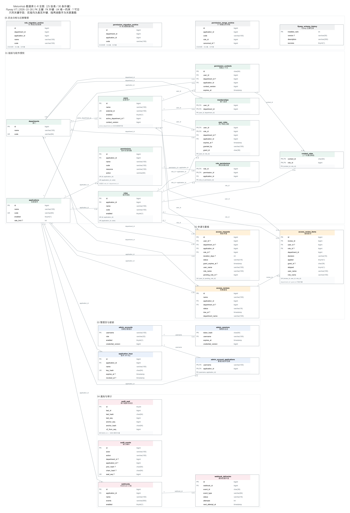
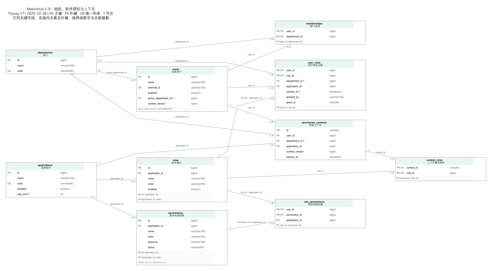
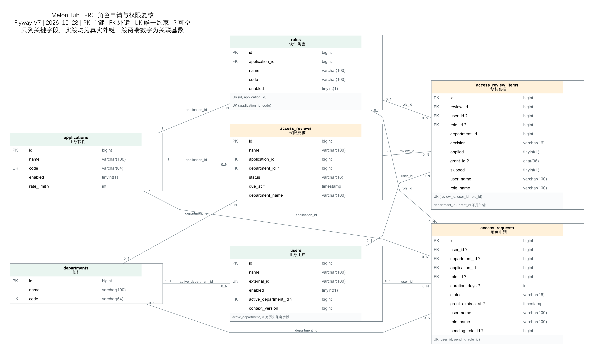
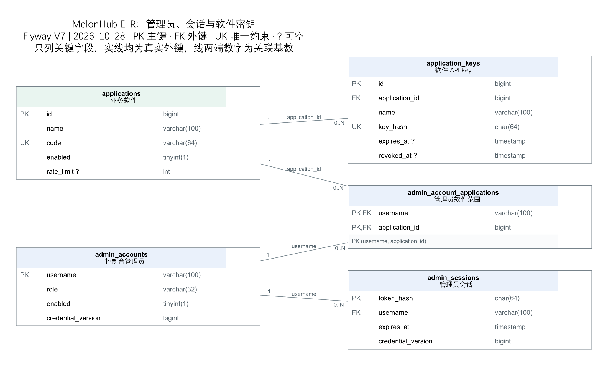
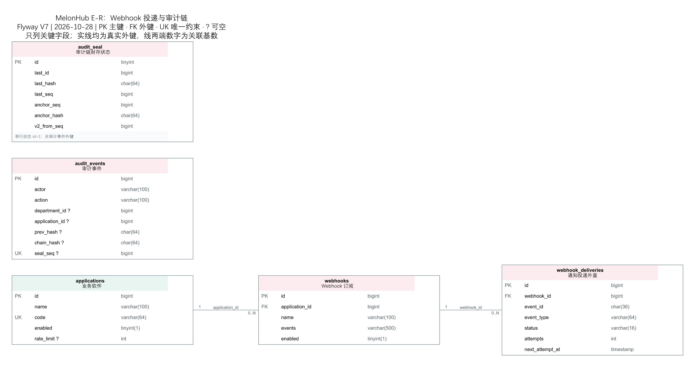

# MelonHub 数据库 E-R 图

更新日期：2026-10-28。依据当前云数据库的只读结构元数据，并逐项核对 Flyway V1–V7，绘制当前 V7 软件共享权限模型。核对结果：**25 张表、30 条外键**，包括 21 张运行表、3 张迁移归档表、1 张 Flyway 管理表。

图中仅展示关键字段、实际主外键和唯一约束；完整列类型、可空性及约束列顺序保存在 [结构快照](ER/schema.json)。快照不含业务数据、连接地址、账号、密码或密钥值。

## 全表图

建议用 [SVG 全图](ER/全表.svg) 放大查看，或使用 [高清 PNG 全图](ER/全表.png) 放入报告。全图包括全部 25 张表和全部 30 条外键；下面的分图便于逐模块阅读，同一张基础表在不同分图中重复出现。



## 如何读图

- 矩形是数据库中的实体表；第一行是实际表名，第二行是中文含义。
- `PK` 是主键，`FK` 是外键，`UK` 是唯一约束。联合主键、联合唯一约束在表格底部完整列出，不能理解为其中每一列都单独唯一。
- 字段后的 `?` 表示可空；未标记表示不可空。`tinyint(1)` 是当前 MySQL 中布尔字段的实际列类型。
- 实线只表示数据库中真实存在的外键。线上标的是子表的外键列；一条复合外键仍只画一条线，不能拆成两条独立外键。
- 靠近父表的 `1` 表示每条子记录必须引用一个父记录；`0..1` 表示子记录可以没有父引用。靠近子表的 `0..N` 表示父记录可以被零到多条子记录引用。
- SVG 中悬停关联线可查看外键名称及 `ON DELETE` 行为。图中没有连接的表不等于业务上没有联系，只表示未建立物理外键。

例如 `applications — roles`：一个软件可以有零到多个角色，每个角色必须属于一个软件。`departments — user_roles`：一条角色分配可以记录一个来源部门，也可以没有来源部门；这不是部门授权隔离。

## 1. 组织、软件授权与上下文



[放大 SVG](ER/核心授权.svg) · [PNG](ER/核心授权.png) · [DOT 源文件](ER/核心授权.dot)

核心关系可按两条路径理解：

1. 组织成员：`departments → memberships ← users`，用户与部门通过成员表多对多关联，可以不属于任何部门。
2. 授权链：`users → user_roles ← roles → role_permissions ← permissions`，用户获得角色，角色获得权限；角色与权限分别由 `applications` 归属和隔离。

`permission_contexts` 属于一个用户和一个软件，`context_roles` 记录这个上下文激活的角色。有效权限还需结合用户/软件启用状态、角色启用状态与分配期限判断，不能仅凭存在关联行就认为允许。

| 必须保留的约束 | 当前定义 |
| --- | --- |
| 角色在软件内编码唯一 | `roles UNIQUE(application_id, code)` |
| 权限在软件内编码唯一 | `permissions UNIQUE(application_id, code)` |
| 同一用户与角色只分配一次 | `user_roles PRIMARY KEY(user_id, role_id)` |
| 角色与权限不能跨软件关联 | `role_permissions(role_id, application_id) → roles(id, application_id)`；`(permission_id, application_id) → permissions(id, application_id)` |
| 用户不能分配到错误软件下的角色 | `user_roles(role_id, application_id) → roles(id, application_id)` |

特别注意：

- 当前 `permissions` **没有 `role_id`、`department_id`**；同一软件的多个角色可以共享一条权限。
- `roles` 没有 `department_id`；没有“部门拥有角色”或“用户直接拥有权限”的关系。
- `users.active_department_id` 仍有物理外键，但只是历史兼容字段，不代表当前全局部门切换或授权边界。
- `user_roles.department_id`、`permission_contexts.department_id` 可空，部门删除时 `SET NULL`；移出部门不自动撤销软件角色或上下文。
- `user_roles.expires_at=NULL` 为永久分配；`grant_id` 标识这一次授予，续期或重新授予后会变化。
- `context_roles` 只有上下文、角色两个物理外键；“激活角色必须属于当前软件且已经分配给用户”等额外规则由服务层检查。

## 2. 角色申请与权限复核



[放大 SVG](ER/申请复核.svg) · [PNG](ER/申请复核.png) · [DOT 源文件](ER/申请复核.dot)

- `access_requests` 保存申请的软件、用户、目标角色、审批状态和期限；用户、角色、部门引用可空，删除相应对象时 `SET NULL`，历史名称快照保留。
- `access_requests UNIQUE(user_id, pending_role_id)` 限制同用户同角色最多一条待审批申请；完成审批后 `pending_role_id` 清空。**`pending_role_id` 本身没有外键**，不能再画一条指向角色的关系线。
- `access_reviews` 属于软件，可选部门筛选范围；一轮复核有多条 `access_review_items`。
- `access_review_items` 通过 `review_id` 归属复核；用户和角色引用可空，保留历史名称快照。
- 条目中的 `grant_id` 用于业务层比对当时的角色分配，**不是指向 `user_roles` 的外键**；`department_id` 也没有物理外键，删除部门不会要求删除这些条目。

申请、复核的软件外键为 `ON DELETE CASCADE`；用户、角色及相关部门的历史保留不能被误解为“删除软件也永久保留全部治理行”。实际删除软件还需先通过应用层的依赖检查。

## 3. 管理员、会话与软件密钥



[放大 SVG](ER/管理员密钥.svg) · [PNG](ER/管理员密钥.png) · [DOT 源文件](ER/管理员密钥.dot)

`admin_accounts` 和业务 `users` 是两套独立身份表，没有相互外键。管理员会话关联管理员账号；软件管理员通过 `admin_account_applications` 指定可管理的软件。该关联表不代表超级管理员、平台管理员也必须逐个绑定软件。

一个软件可有多个 `application_keys`。管理员会话 token 与 API Key 只存哈希，图中列名表示字段定义，不包含任何凭据值。`created_by`、`granted_by` 等操作人文本不是管理员外键。

## 4. 通知投递与审计



[放大 SVG](ER/通知审计.svg) · [PNG](ER/通知审计.png) · [DOT 源文件](ER/通知审计.dot)

`applications → webhooks → webhook_deliveries` 是真实的一对多关联，投递表承载事务外盒及重试状态。

`audit_events` 与 `audit_seal` 在图中独立列出，原因是**它们没有互相的物理外键**。`audit_events.department_id/application_id` 也没有部门或软件外键；`audit_seal.last_id/last_seq` 是应用维护的链尾信息。哈希链、封存顺序、锚点由服务实现，不能画成普通的一对多外键关系。

## 5. 归档与迁移管理

以下四张表位于全图的“历史归档与迁移管理”区域，不参与日常授权判断。

| 表 | 用途与约束 |
| --- | --- |
| `role_migration_archive` | V6 升级前角色快照；保留旧部门、软件、编码，没有主键或外键 |
| `permission_migration_archive` | V6 升级前未关联权限归档；没有主键或外键 |
| `permission_merge_archive` | V7 重复权限组的旧定义；保留旧 `role_id` 与 `canonical_id`，没有主键或外键 |
| `flyway_schema_history` | Flyway 自身管理表，`installed_rank` 为主键；没有业务外键 |

三张归档表通过 `CREATE TABLE ... AS SELECT` 创建，虽然包含 `id`，也不能据此标注为主键。`canonical_id` 是追溯元数据，不是强制引用当前 `permissions.id` 的外键。

## 图与数据来源

- 当前云正式库 `melonhub_rbac` 的 `information_schema.COLUMNS`、`KEY_COLUMN_USAGE`、`REFERENTIAL_CONSTRAINTS`，仅以只读事务读取结构；未查询员工资料、密钥值或修改数据库。
- `flyway_schema_history` 显示 V1–V7 均成功应用；与 [数据库迁移源文件](../backend/src/main/resources/db/migration/) 核对。
- 外键分布：核心授权 15 条、申请复核 9 条、管理员与密钥 4 条、通知 2 条，共 30 条。模块分图还可能包含重复展示的基础表关系，不应直接把各分图线数相加。
- 删除规则以结构快照的 `DELETE_RULE` 为准。`NO ACTION` 在当前 MySQL 约束下限制直接删除；它与控制台通过服务检查后按顺序删除依赖不是同一件事。

## 修改与重建

生成器：[ER/render.cjs](ER/render.cjs)。输入：[ER/schema.json](ER/schema.json)。每张图均保留 DOT、SVG 和 PNG 三种文件；只需重建图片时不连接数据库，也不读取 `.env`。

在项目根目录执行：

```powershell
npm.cmd install --prefix .local/er-tools --no-audit --no-fund --ignore-scripts @viz-js/viz@3.9.0 @resvg/resvg-js@2.6.2
node docs/ER/render.cjs
```

绘图工具安装在忽略目录 `.local/er-tools`，不修改前后端依赖。中文渲染使用系统字体，当前 Windows 环境有微软雅黑。数据库未来升级后，需要先更新结构快照，核对新增表/外键及中文说明，再更新生成器中的 V7 数量检查和日期，重新生成全部图片。

其他设计说明见 [数据库设计](数据库设计.md) 与 [详细设计](详细设计.md)。本次仅新增结构文档与图片，不改变数据库、授权规则或部署。
