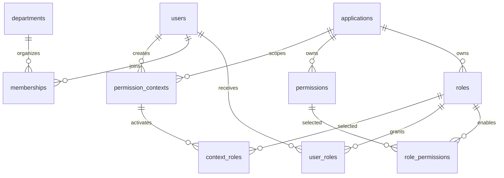

# 数据库设计

更新日期：2026-10-22。本文描述 Flyway V7 后的结构；V1–V6 保留历史，不修改已应用迁移。

## 授权模型

软件是角色和权限的隔离边界：软件分别拥有角色与权限，角色和权限通过关联表形成多对多关系。同一软件的多个角色可以共享同一条权限定义。部门仅管理成员、筛选人员和批量设置软件角色，不参与授权判断。用户可以没有部门，也可属于多个部门。

- 角色编码在软件内唯一：`UNIQUE(application_id, code)`。
- 权限编码在软件内唯一：`UNIQUE(application_id, code)`；不同软件可以使用相同编码。
- 用户可以被分配多个软件的多个角色；没有用户直接权限、角色继承或部门授权。
- `role_permissions` 记录角色授予的权限集合，同一权限可关联多个角色，但角色和权限必须属于同一软件。
- 权限可以独立创建，无需角色。删除角色只删除其关联，保留权限定义及其他角色关联；修改共享权限会影响所有引用角色，删除权限会级联移除全部角色关联。
- 校验结果为该软件中已激活、已分配、启用且未到期角色的权限编码并集。相同编码去重；resource/action 仅是元数据。



## 核心表与约束

| 表 | 主要字段 | 主键、唯一键与外键 |
| --- | --- | --- |
| applications | id、name、code、enabled、rate_limit | id 主键；code 唯一；软件是授权隔离边界 |
| roles | id、application_id、name、code、description、enabled | id 主键；(application_id,code) 唯一；(id,application_id) 复合唯一；软件外键 |
| permissions | id、application_id、name、code、resource、action | id 主键；(application_id,code) 唯一；(id,application_id) 复合唯一；application_id 外键指向 applications；不含 role_id |
| role_permissions | role_id、permission_id、application_id | (role_id,permission_id) 主键；(role_id,application_id) → roles(id,application_id)，(permission_id,application_id) → permissions(id,application_id)；删除角色或权限时级联删除关联 |
| users | id、external_id、name、email、enabled、context_version | id 主键；external_id 唯一；active_department_id 为历史兼容字段，不参与授权 |
| memberships | user_id、department_id | 联合主键；只表达组织成员关系，移出部门不删除软件角色 |
| user_roles | user_id、role_id、application_id、department_id、expires_at、granted_by、granted_at、grant_id | (user_id,role_id) 主键；独立用户外键；(role_id,application_id) 复合外键；department_id 可空，只记分配来源，部门删除时 SET NULL |
| permission_contexts | id、user_id、application_id、department_id、context_version、expires_at | id 为 token 的 SHA-256；部门可空且删除时 SET NULL；用户/软件外键；上下文有效期一小时 |
| context_roles | context_id、role_id | 联合主键；上下文和角色外键，均级联删除 |

编码区分大小写。后端事务检查软件归属，数据库复合外键再次拒绝跨软件角色分配和权限关联，同软件跨角色共享权限是合法操作。

`expires_at=NULL` 表示永久；到期即不计入权限，无需等待清理任务。每次重新授予或变更期限生成新的 `grant_id`，复核仅能撤销快照中的那次分配。批量追加保留已有有效角色及期限。

## 治理与安全表

| 表 | 职责 |
| --- | --- |
| application_keys | 软件 API Key 哈希、前缀、有效期与吊销；每软件最多十个有效密钥 |
| admin_accounts、admin_sessions | 管理员角色、密码哈希、MFA、锁定、会话及 credential_version |
| admin_account_applications | 软件管理员可管理的软件集合 |
| access_requests | 申请、审批、期限及名称快照；同用户同角色待审批唯一；无部门仍可审批 |
| access_reviews、access_review_items | 软件复核，可按当前部门成员筛选；保存 grant_id、名称快照与决定 |
| webhooks、webhook_deliveries | 软件通知、签名密钥与事务外盒、租约、重试状态 |
| audit_events、audit_seal | 审计详情、封存序号、哈希链及保留期锚点 |
| role_migration_archive | V6 前角色快照，追溯原部门与原编码 |
| permission_migration_archive | V6 前未关联角色的权限定义，归档后不产生授权 |
| permission_merge_archive | V7 合并组内的全部旧定义（含旧 role_id、名称、resource/action 和 canonical_id），用于追溯合并结果，不参与授权 |

API Key、上下文 token、管理员会话仅保存 SHA-256；管理员密码使用 BCrypt。敏感配置、Webhook/TOTP 密钥不写入文档、示例和日志。

## V6 历史迁移

以下为历史步骤；其中角色独立权限已由 V7 替换，不是当前约束。

1. 备份授权数据，停止旧版本写入；新程序通过 Flyway 执行 `V6__role_owned_permissions.sql`。
2. 共享权限拆成各角色独立定义，原关联集合不变；未关联权限归档。
3. 同软件内原来分属不同部门的同编码角色保持独立，编码改为 `LEFT(原编码,50):legacy:角色ID`。角色 ID、分配、期限均保留，不自动合并。
4. 删除角色、权限、角色权限关联中的部门字段；用户角色的部门改为可空来源信息。
5. 清除旧上下文并递增用户版本，业务侧重新获取 token。新缓存前缀为 `melonhub-role-v2:`，避免命中旧结果。

MySQL DDL 不能整体事务回滚；升级前保留数据库备份。失败时先确认 Flyway 记录和实际结构，不直接删除历史或重新初始化。角色统一到软件后，原有分配作为软件角色保留；上线前应复核是否仍需这些授权。

## V7 升级策略

1. 备份授权表并停止旧程序，启动新版本由 Flyway 执行 `V7__application_shared_permissions.sql`，不修改或重跑 V6。
2. 按 `(application_id, code)` 分组，以 ID 最小的权限为共享定义。该定义的名称、resource、action 和创建时间保留；所有重复组的旧定义（包括保留行）完整写入 `permission_merge_archive`，其 `canonical_id` 指向共享 ID。元数据有差异时可从归档复核。
3. 将原角色权限关联重新指向共享 ID，去重后删除多余定义。权限编码和每个角色原有的权限编码集合不变；保留用户角色、有效期、grant_id 以及软件间隔离。原本未勾选的权限不会因此自动授予。
4. 移除 `permissions.role_id`、角色归属外键和旧唯一键；新增软件内编码唯一键、软件外键及角色权限关联的软件复合外键。
5. 现有上下文继续生效，无需重新分配角色；配置变更仍通过软件代失效。升级时应停止旧实例，避免旧 SQL 和新表结构混用。V7 不恢复 V6 归档中此前未启用的权限，也不合并角色。

V7 同样适用于空库升级。DDL 失败后先检查 Flyway 状态和实际表结构，不盲目重跑或清库。

## 上下文与数据源

部门变化不使软件上下文失效。修改用户身份、停用用户、强制下线撤销用户上下文；重新分配、审批或复核回收撤销该用户在该软件的上下文。角色启停和权限变更在下一次校验生效。

MySQL 为唯一持久数据源，正式库 `melonhub_rbac`、测试库 `melonhub_rbac_test` 均连接云端并强制 TLS。没有本地 MySQL/Redis 创建、启动、停止逻辑。Redis 默认关闭；服务器部署后设置 `CACHE_ENABLED=true` 与 `REDIS_*`，用于缓存和限流。缓存沿用代标记与 epoch 协议，配置变更触发软件代失效，到期缓存受最早分配到期时间限制。

## 清单格式

软件级 `version:3` 不包含部门或权限所属角色：

```json
{
  "version": 3,
  "permissions": [
    {"code":"item:read","name":"读取","resource":"item","action":"read"}
  ],
  "roles": [
    {"code":"reader","name":"阅读者","description":"","enabled":true,"permissions":["item:read"]},
    {"code":"reviewer","name":"复核者","description":"","enabled":true,"permissions":["item:read"]}
  ]
}
```

导入按软件内角色编码、软件内权限编码匹配；权限只定义一次，可由多个角色引用。列出角色的权限集合整体替换，未列出配置和用户分配、期限保留。修改清单中的共享定义也影响未列出但已引用它的角色。旧 v1/v2 清单拒绝直接导入，应升级后重新导出，或先按软件内编码合并旧定义并复核后转换为 v3。
