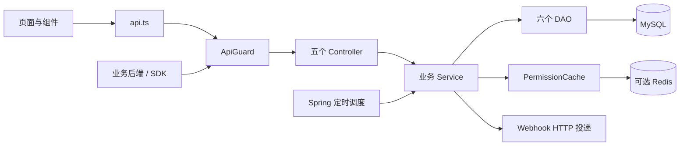
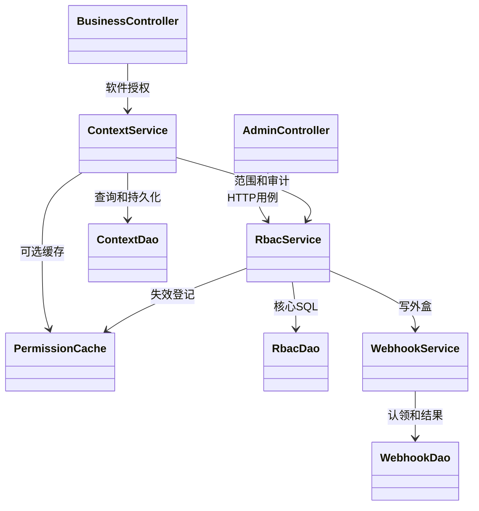
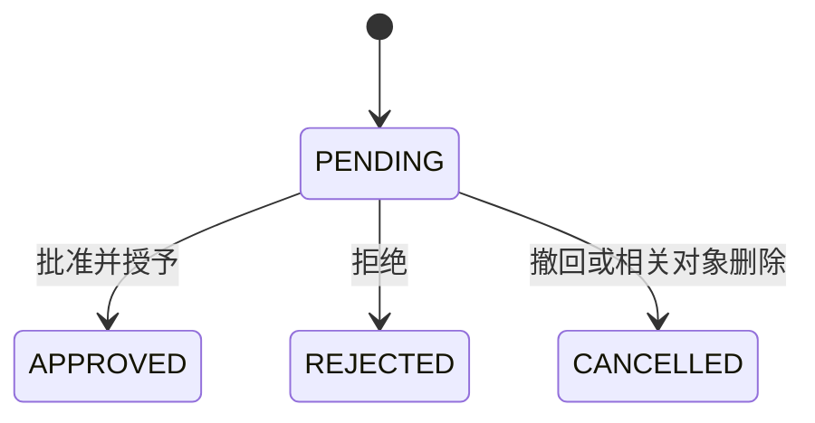
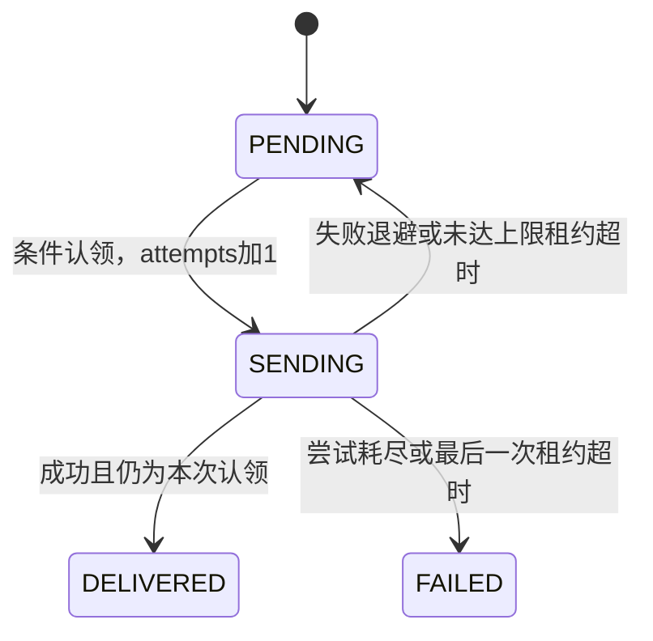

# MelonHub 详细设计文档

更新日期：2026-10-22。版本基线：当前源码、Flyway V7 的软件共享权限模型。本文描述已实现设计及其限制，面向开发交接、课程设计与答辩；链路式阅读见[项目讲解与数据链路](项目讲解与数据链路.md)，表结构见[数据库设计](数据库设计.md)。

## 1. 设计范围与需求基线

### 1.1 系统目标

为企业内部多个业务软件提供统一 RBAC 授权管理和在线权限校验，支持用户组织、角色权限配置、临时授权、审批复核、审计、变更通知和 Java 接入。

平台负责授权，不负责业务软件的用户登录与业务数据，也不做 OAuth/OIDC/IdP/SSO。业务软件完成自身认证后提交可信 externalId。管理员平台角色与业务角色是两个独立体系。

### 1.2 关键规则

| 编号 | 规则 |
| --- | --- |
| R01 | 软件拥有角色，角色编码在软件内唯一 |
| R02 | 权限归属软件，编码在软件内唯一；多个角色可共享同一权限 |
| R03 | 用户多角色，无用户直接权限、继承、ABAC 或通配授权 |
| R04 | 部门只管理成员和筛选，无部门用户可授权和申请；部门变化不撤销软件授权或上下文 |
| R05 | 权限结果是当前软件已分配、激活、启用且未到期角色的已选权限编码并集 |
| R06 | 期限属于用户角色分配；重新授予或改期限生成新 grant_id，复核只回收同一次授予 |
| R07 | 管理接口按管理员职责与可见软件授权，业务接口由 API Key 固定软件 |
| R08 | MySQL 为唯一持久数据源，正式/测试库隔离；当前 Redis 默认关闭 |
| R09 | 影响授权的写入要协调事务、缓存失效、必要的通知和审计 |
| R10 | 前端只接收当前查询的有效响应，批量追加保留已有有效角色与期限 |

### 1.3 非功能要求

需要可维护的职责划分、清晰事务边界、跨软件隔离、故障时拒绝不确定授权、可定位的错误和审计、受限的资源使用及桌面/手机可用界面。代码中的缓存、限流和线程参数是配置与实现能力，不是当前生产吞吐或高可用的验收保证。

## 2. 总体结构与设计方法

### 2.1 逻辑部署单元

| 单元 | 技术与入口 | 职责 |
| --- | --- | --- |
| 控制台 | frontend；Vue 3、TypeScript、Pinia、Router、Ant Design Vue | 管理员操作与可视化 |
| 后端应用 | backend；Spring Boot、JDBC、Bean Validation、Flyway | HTTP、授权计算、治理、后台任务 |
| 持久层 | 云 MySQL；正式 melonhub_rbac、测试 melonhub_rbac_test | 唯一持久事实与事务 |
| 可选缓存 | Spring Data Redis / Lettuce | 可重建结果缓存、限流计数；当前默认关闭 |
| 接入 SDK | sdk/java；独立 Maven 工程、JDK HttpClient | API 调用、上下文复用、业务入口检查 |
| 运维入口 | scripts、一键 cmd、.run | 构建、启停 Java/Vite、测试和 IDEA 配置 |

后端是按职责拆包的单体，不是微服务群；前端与后端通过 JSON HTTP 通信。根 Maven 只聚合 backend，SDK 独立构建。源码目标 Java 17，项目未使用 MyBatis/JPA 作为持久化框架。



### 2.2 方法选择及理由

采用需求驱动的数据建模与分层设计：先确定软件、角色、权限和分配的真实关系，再划分 HTTP、业务和数据访问职责。采用构造器依赖注入，业务以事务脚本组织用例；没有为每个实现类机械增加接口或 Repository 抽象。

选择 Spring JDBC 是为了明确控制联接、所属过滤、行锁和条件更新。关系约束由唯一键与复合外键兜底。采用局部 record 和 Map 以降低小规模视图转换成本，但响应契约的编译期保障弱于完整 VO/Entity 体系。

并发按用例选行锁、条件更新或授予版本；读授权不加行锁。对高频可重建结果采用可选缓存，对跨系统通知采用事务外盒；二者都明确区分数据库提交与外部系统执行。

从表现模式看，后端由Spring MVC接收和返回HTTP，前端采用Vue响应式状态与模板绑定；Service/DAO是后端内部的分层，不应把整个前后端工程硬套为一个三类文件组成的MVC。Spring的IoC容器管理组件，构造器注入表达对象协作；`@Transactional`通过代理在业务调用外组织事务，是横切机制，不是写在DTO里的规则。



箭头表示持有或调用协作者，不表示Java继承。主要Service是无请求专属可变字段的Spring组件；每次请求的DTO、局部集合和视图在方法内创建。缓存、限流器和SDK门面是有共享状态的例外，使用并发容器、脚本或同步机制管理。

## 3. 数据和对象设计

### 3.1 数据关系摘要

```text
applications 1─N roles；applications 1─N permissions
roles 1─N role_permissions N─1 permissions（同软件内多对多共享）
users N─M roles，通过 user_roles（期限、授予人、grant_id、可空部门来源）
users N─M departments，通过 memberships（组织关系）
users 1─N permission_contexts N─1 applications
permission_contexts N─M roles，通过 context_roles（激活集合）
```

角色和权限的软件一致性由复合外键保证。同软件同编码权限只有一条共享记录；有效校验按编码并集去重，权限反查默认返回全部授予角色，也可按 roleId 筛选。删除部门不删除软件角色，分配来源字段可以置空。V7 合并同编码定义并归档重复组，保留角色关联和分配期限，完整迁移规则以数据库设计为准。

### 3.2 Requests：输入 DTO 的详细设计

文件：[Requests.java](../backend/src/main/java/com/melonhub/rbac/dto/Requests.java)。外层是不可实例化的 final 容器，内层采用不可变 record，声明传输字段与 Jakarta Validation 约束。

| DTO | 主要字段和约束 | 对应目的 |
| --- | --- | --- |
| Login | username、password 必填，mfaCode 可选 | 登录及 MFA 第二步 |
| PasswordChange / PasswordReset | 当前密码/新密码，长度约束 | 自助改密/管理员重置；Service 补 UTF-8 72 字节上限 |
| Account / AccountUpdate | username、displayName、四类 role、enabled、applicationIds | 创建与调整管理员，创建另需密码 |
| Department | name、code | 组织定义，编码格式受限 |
| Application | name、code、description、owner | 接入软件资料 |
| ApiKey | name、expiresInDays | 1–3650 天或永久，软件密钥创建 |
| User | name、externalId、email、departmentIds | 用户资料与组织关系；部门列表允许空 |
| Role | name、code、description | 软件角色，编码最多 100 字符 |
| Permission | name、code、resource、action；roleId 仅作旧请求兼容 | 权限定义归属当前软件 |
| Ids / Enabled | ids 集合 / 必填布尔 | 替换关联集合、切换状态 |
| Context | externalId、departmentId、activeRoleIds、switchDepartment | 创建软件上下文；后两种部门字段语义按当前兼容规则解释 |
| Check | 1–100 个权限编码 | 批量在线判断，不允许空集合产生无意义结果 |
| Simulation | userId、applicationId、可选激活角色与权限、departmentId | 不发放 token 的诊断 |
| UserRoles | 完整 ids、expiresInDays、逐角色 expiries | 单人软件角色替换 |
| RoleExpiry | roleId、OffsetDateTime expiresAt | 单角色期限，null 为永久 |
| BatchUserRoles | userIds、roleIds 各 1–1000，expiresInDays | 批量追加，保留已有有效分配 |
| RateLimitUpdate | perSecond，0–100000 或 null | 软件限额；0 不限，null 恢复默认 |
| AccessRequestSubmit / AccessRequestCancel | externalId、roleId、reason、durationDays 等 / externalId | 业务软件代用户申请和撤回 |
| RequestApprove / RequestReject | durationDays、comment、permanent / comment | 批准或拒绝；永久与天数互斥由 Service 检查 |
| ReviewCreate / ReviewItemDecision | name、applicationId、可空 departmentId、dueDays / KEEP或REVOKE、comment | 发起复核和记录决定 |
| MfaCode / MfaDisable | 6 位数字 code / password 与 code | 绑定确认与停用验证 |
| Webhook | name、http(s) url、secret、events、enabled | 订阅事件与签名配置；events 为数组 |
| UserImport / UserImportRow | 1–500 行；每行用户资料及 departmentCodes | 导入逐行校验，坏行报告而非统一拒绝全部 |
| Manifest / ManifestRole / ManifestPermission | version 必须 3，软件共享权限定义、角色及已选编码集合 | 软件级配置导入 |
| DomainCopy / ManifestDepartment | 历史部门复制/清单结构 | 类型保留兼容，不构成当前跨部门复制或 v1 清单能力 |

DTO 层负责必填、长度、范围、嵌套集合；Service 层负责存在性、所属关系、期限语义、状态转换；数据库负责最终唯一性和引用完整性。三层不能互相替代。

### 3.3 输出、局部记录和映射

后端没有统一 `vo/entity/mapper` 包。多数列表返回 `List<Map<String,Object>>`，单对象返回 Map，分页为 `{items,total,page,size}`，修改通常返回 `{id}` 或 `{ok:true}`。接口不能假设统一 `data` 包装。

| 记录/方法 | 结构及用途 |
| --- | --- |
| RbacDao.Page / AuditFilter | 分页数据与总数 / 审计条件值对象 |
| AuthDao.AccountRow | 账号认证快照，包括密码哈希、MFA 与凭据版本；不能直接作为公开响应 |
| AuthDao.SessionRow / KeyRow | 管理会话校验结果 / 软件密钥身份和有效性 |
| ContextDao.ContextRow / ContextState | 上下文持久字段 / 当前用户软件和版本是否合法 |
| ContextService.Meta / Role / Payload / Access | 缓存元信息、角色摘要、计算结果与最早到期、内部组合；都不是数据库实体类 |
| AuthService.KeyMeta / KeyState | API Key 不变身份与可变化有效状态分开缓存 |
| PermissionCache.Status / Lookup | HIT、MISS、NONE、BYPASS 与读取结果/可回填键 |
| AuditDao.SealRow / Link | 链尾与锚点记录 / 某一封存序号和哈希 |
| AdminPrincipal / ApplicationCaller | 认证后的管理员/调用软件身份，存 request 属性 |
| RbacService.page / attach | 将 DAO 分页和关联对组装为接口结构 |
| ContextService.view / AuthService.view | 有选择地公开上下文/管理员字段，避免返回认证内部状态 |

映射分四步：JSON → DTO（Jackson）；ResultSet → Map/record（JDBC）；内部数据 → 返回视图（Service）；视图 → JSON（消息转换器）。`ObjectMapper` 只负责 JSON，不能称为 MyBatis Mapper。Map 的字段类型转换依赖真实 SQL 和测试，前端 TypeScript 不提供运行时响应验证。

## 4. 后端逐类设计

本节覆盖 `backend/src/main/java/com/melonhub/rbac` 的所有 Java 源文件。表中的依赖列列出主要协作者，不穷举日志器、集合和普通配置参数。

### 4.1 启动与配置类

| 类 | 职责与关键入口 | 设计理由和边界 |
| --- | --- | --- |
| RbacApplication | Spring Boot 主入口、启用定时任务 | 根包扫描各模块，运行 Web 应用和维护任务；不放业务规则 |
| CloudDatabaseConfiguration | `databaseTargetGuard()` 在 Flyway 前校验 profile、云入口、端口、固定 schema、TLS 和 JDBC 参数 | 防止误连接其他数据库再迁移；拒绝 local；名称保留历史，但实现是云数据源约束 |
| RedisConfiguration | `failFastRedis()` 配置 Lettuce 自动重连、断线拒绝命令、连接及命令超时 | Redis 故障尽快回退，防止请求堆在客户端离线队列 |
| DemoData | ApplicationRunner，`SEED_DEMO` 开关及已有部门判断后调用 RbacService 建示例 | 演示数据复用正式业务规则；默认关闭，不是正式库初始化必需步骤 |

### 4.2 Controller 类

Controller 通过构造器取得 Service，不依赖 JdbcTemplate。方法负责路由、HTTP 参数、`@Valid`、操作者授权与响应封装。过滤器提前完成认证，但每个管理入口仍检查 request 中身份和操作范围。

| 类 | 路由、主要方法组 | 依赖与设计说明 |
| --- | --- | --- |
| AuthController | `/api/health`、`/api/auth/*`：login/logout/me、改密、MFA | AuthService、RbacService；健康与登录公开，其他操作需要认证 |
| AdminController | `/api/admin`：部门/软件/密钥/用户/角色/权限、assignments、simulate、overview、audit | RbacService；列表按可见软件过滤；页码至少1、普通分页最多200；旧 copy 路由仍在但业务明确拒绝 |
| GovernanceController | `/api/admin`：申请、复核、Webhook、清单、导入、反查、到期、搜索、状态、验链 | GovernanceService、WebhookService、ConsoleService、AuditSealService 等；按资源所属软件校验读写，平台级功能另校验职责 |
| AccountController | `/api/admin/accounts`：创建、修改、删除、重置密码/MFA、解锁 | AuthService；超级管理员入口，保留最后一位启用超级管理员由 Service 保护 |
| BusinessController | `/api/v1`：软件角色权限、用户分配、contexts、申请和只读授权查询；兼容旧部门路径 | RbacService、ContextService、GovernanceService；从 ApplicationCaller 固定软件，防止调用方伪造软件 ID |

业务 API Key 是受信任的软件级调用能力，并不只是“查询按钮权限的只读凭据”；当前业务 Controller 也开放角色、权限和分配写入，接入方应按此保管密钥。

### 4.3 Service 类

#### RbacService：配置与分配事务

主要依赖 RbacDao、ContextDao、GovernanceDao、PermissionCache、WebhookService 和事务管理器。包含基础配置与 RBAC 用例，是当前较大的事务脚本服务。

| 方法组 | 规则与处理 | 事务/副作用 |
| --- | --- | --- |
| health / domain / scoped / page | 健康、软件及非零部门存在、对象软件归属、分页视图 | 读操作；domain 不再要求部门准入或成员资格 |
| department / deleteDepartment | 组织定义与成员依赖提示 | 写事务与审计；删除部门不回收软件授权 |
| application / updateApplication / applicationStatus / deleteApplication | 软件接入与状态、依赖检查 | 状态/删除清理软件上下文并失效缓存，按实际用例写通知 |
| createKey / revokeKey / rotateKey | 软件密钥生命周期 | 锁软件保证最多10个有效密钥；原文只在创建/轮换响应出现 |
| users / user / userStatus / deleteUser / userAccess / revokeUserContexts | 资料、组织、状态、只读授权视图与强制下线 | 身份变更/停用/删除/下线影响上下文；纯部门变化保留授权 |
| roles / role / roleStatus / deleteRole | 软件内角色编码唯一，处理待申请和关联 | 更新/启停/删除触发软件缓存变化及相应审计/事件 |
| permissions / permission / deletePermission | 权限属于当前软件，可由多个角色共享；修改/删除影响所有引用角色 | 修改/删除使软件缓存失效；创建定义尚未勾选不改变现有权限 |
| rolePermissions | 锁角色、验证权限全属当前软件、替换勾选集合 | touchApplication、role.permissions.changed、差异审计 |
| roleMembers / replaceRoleMembers | 角色成员完整替换，新增永久、保留已有分配期限 | 按用户→角色→分配锁定；有迟到成员回滚并最多3次尝试 |
| assignments / domainAssignments | 用户软件角色及期限、按成员分页附加角色和期限 | 部门只筛选用户，角色本身按软件读取 |
| userRoles | 完整集合替换、期限优先级、改变授予生成 grant_id | 锁用户、撤销该用户软件上下文、touchUser、通知与审计 |
| addUserRoles | 批量补缺或重新授予过期所选角色，不改已有有效分配 | 锁用户并检查所选部门成员，逐用户记录真正发生的变化 |
| simulate | 返回角色/权限、问题与说明，不创建上下文 | 诊断入口不能替代受保护业务操作前的在线校验 |
| copyDomain | 当前直接返回业务错误 | 已统一软件角色，跨部门复制取消 |
| overview / events / audit | 概览、审计查询和业务日志写入 | audit 记录来源和操作者；事务用例中的审计随事务提交 |

内部 `LateMembers` 是有限重试的控制异常；它携带本轮未先锁住的用户集合，不是对外业务实体。每次成员替换尝试用 `PROPAGATION_NESTED`：无外层事务时是一段独立事务；有外层事务时仅回到保存点，锁可能持续至外层结束。

#### ContextService：上下文与有效权限

依赖 ContextDao、RbacService、PermissionCache、ObjectMapper、PlatformTransactionManager。`issue/revoke` 是写事务；`resolve` 缓存未命中时通过 TransactionTemplate 包住一致性读取，当前代码未对该模板额外设置 `readOnly=true`，不能将其误讲为显式只读注解。

| 方法 | 输入/输出与算法 |
| --- | --- |
| issue(app, Requests.Context, actor) | 锁用户，查有效分配，检查激活子集，生成一小时上下文；返回 token 与视图；提交后缓存元信息 |
| resolve(app, token) | token 格式与哈希 → 缓存 → 快照查询 → 检查软件、有效期和状态 → 有效 Access 或 CONTEXT_INVALID |
| load(hash) | DAO state → Meta，状态有效则 compute，否则 Payload.INVALID |
| compute(hash, meta) | 有效角色及权限编码并集，收集最早分配到期为 refreshAt |
| effective(app, token) | 将有效 Access 映射为当前角色、权限与元信息 |
| check(app, token, requested) | 精确 code 集合包含判断，生成 decisions；全部为真则 allowed=true |
| revoke(app, token, actor) | 删除此软件对应上下文，touchUser，提交后清理元缓存，审计 |
| view/read/write | 对外字段选择及缓存 JSON 编解码；缓存解析失败可回源 |

Meta 使用字符串形式保存用户/部门/软件 ID，方法转换成 long；Role 是角色摘要；Payload 只存可重算结果与到期限制；Access 组合两者。这把不变元信息与易变授权状态分开缓存。

#### AuthService：认证及管理员生命周期

实现 ApplicationRunner，依赖 AuthDao、RbacService、PermissionCache、ObjectMapper 等。启动时按配置补建初始账号，只有明确恢复开关才重置；普通启动不覆盖已存在账号密码。

| 方法组 | 设计 |
| --- | --- |
| login / admin / sessionHash / logout / me / view | BCrypt 校验、失败计数和锁定、可选 TOTP；创建会话必须仍匹配校验时凭据快照；请求认证检查账号启用、版本、会话期限和空闲时间 |
| changePassword / resetPassword | 密码长度和 UTF-8 字节上限检查；改变 credential_version；自助改密把当前会话更新到新版本并删除其他会话，管理员重置使旧会话失效 |
| setupMfa / confirmMfa / disableMfa / resetMfa | 待绑定密钥、验证码确认、原子消费时间步、防重放；生效/停用/重置结束旧会话 |
| accounts / createAccount / updateAccount / unlock / deleteAccount | 管理员资料、职责和可管理软件；锁启用超级管理员集合，保留至少一人 |
| application / flushKeyUsage | 软件密钥校验和可选缓存；最近使用在内存汇总，每60秒批量写入，避免每次认证更新数据库 |
| purgeSessions | 维护任务删除过期/闲置会话 |

密码为 BCrypt cost 12；12–100字符且 UTF-8 最多72字节。5次失败锁15分钟，管理员会话8小时、默认空闲30分钟。认证版本不是加密算法，而是使凭据改变后旧会话失效的关联值。

#### GovernanceService：申请、复核、导入和反查

依赖 GovernanceDao、RbacDao、ContextDao、PermissionCache、RbacService、WebhookService 和 Validator；通过Spring事务注解声明写用例边界。

| 方法组 | 设计和理由 |
| --- | --- |
| submit / requests / request / myRequests / cancelOwn | 校验角色软件、申请人、状态，保存名称快照；同用户同角色待审批唯一；撤回只允许本人本软件且仍待处理 |
| approve / reject | 只处理 PENDING，条件更新防重复决定；批准在同事务授予角色与改状态，期限支持永久；失败时一起回滚 |
| myAccess | 只读返回该软件用户角色和有效权限，不新建上下文 |
| createReview / reviews / review / reviewItems | 建复核并保存分配 grant_id 与名称快照；部门只筛选当前成员 |
| decideReviewItem / closeReview | 锁 OPEN 复核，记录决定；关闭按 grant_id 回收，变化的分配 skipped；未决保留 |
| expireAssignments | 分批条件删除到期分配，只有成功删除者发事件和审计，touchUser |
| importUsers | 外层事务中逐行验证，捕获ApiException/DataIntegrityViolationException并报告失败，成功行继续处理；更新资料并补部门，不重置角色；没有逐行保存点，也不是逐行独立提交 |
| exportManifest / importManifest | 软件级 v3；导出只读事务快照；导入按软件角色编码和软件内权限编码匹配，更新列出配置，保留用户分配期限 |
| permissionHolders / expiringAssignments | 权限来源和持有人反查、即将到期报表；共享权限可按授予角色筛选 |

`grant_id` 防止复核快照覆盖后续授权；历史名称快照使用户或角色删除后仍可理解审批和复核。保留名称不是永久保留在线权限，历史表也不能用于绕过当前状态校验。

#### WebhookService：事件外盒和网络投递

依赖 WebhookDao、RbacDao、ObjectMapper、HTTP 客户端和有界发送线程池。`EVENT_TYPES` 是允许订阅和发出的事件契约，新增事件需同步前端标签和必要的 SDK 失效集合。

`create/update/delete` 管理订阅，`emit/emitAll` 在当前数据库事务中把 JSON 负载写入投递表。`scheduledDeliveries/dispatch` 有限认领后异步派发，`deliverNow` 则是调用线程同步发送的辅助入口；`post/send/reschedule` 执行网络、签名、结果更新与重试。默认4线程、每批最多20条、5秒HTTP超时、5分钟租约、最多8次尝试。

签名为 `t=<秒>,v1=<HMAC-SHA256(secret,t+"."+body)>`。停用订阅暂停发送但保留队列；租约过期可重新认领，达到最后一次时转 FAILED。结果更新同时匹配 SENDING 与 attempt，防止旧工作线程覆盖新认领。签名证明消息持有密钥，不提供消息体加密。

#### AuditSealService：审计封存、清理和校验

依赖 AuditDao 和事务管理器，`scheduledSeal()` 每10秒触发封存（初始延迟15秒）。`sealNow()` 锁审计封存单行，依次分配 seal_seq、写 prev_hash/chain_hash 和链尾；不是对每次业务请求同步等待哈希全链验证。

`verify(fromSeq,limit)` 检查链连接、内容、尾部，limit最多50000，返回继续位置。`purge(days)` 按前缀推进锚点后删除。v2规范化按序号及“长度:值”字段编码，历史v1记录按原规范校验。此类负责链协议，AuditDao 负责相应数据库读写及规范化/哈希辅助。

#### ConsoleService：搜索与状态聚合

依赖 RbacDao、GovernanceDao、WebhookDao、AuditDao、PermissionCache。`search()` 组合软件、部门、用户和角色结果，软件与角色查询按管理员可见软件过滤；当前不返回独立权限搜索结果。`status()` 聚合数据库、缓存、队列、复核和审计指标，待申请和开放复核计数接受可见软件条件；部分运行总量是平台级指标，不能笼统称为所有字段均软件隔离。状态查询失败时保持预期字段并报告降级，方便前端稳定渲染。

#### MaintenanceService：后台维护入口

依赖 ContextDao、AuthService、GovernanceService、WebhookDao、AuditSealService。`expireAssignments()` 每60秒分批清到期角色；`purgeExpired()` 每5分钟清过期上下文、会话和可清理投递；`purgeAudit()` 在 Asia/Shanghai 每天03:30按保留期处理审计。维护开关控制这些任务；缓存 recover 和 Webhook 投递各有自己的逻辑和开关。

### 4.4 DAO 类

所有 DAO 使用 `@Repository`、构造器注入 JdbcTemplate，SQL 保留在数据访问层。参数值用占位符绑定；少量动态表/列选择必须来自代码中的允许集合，不能直接把用户字符串拼进 SQL。

| 类 | 数据和主要方法组 | 映射及并发方式 |
| --- | --- | --- |
| RbacDao | 核心组织、用户、软件、密钥、角色、权限、分配、概览与普通审计；insert/page、scopedExists、锁方法、grantRole、关联替换 | 主要 Map 和 Page；列别名对齐前端；GeneratedKeyHolder 取新增 ID；Where 组合条件，IN 占位符与分页参数绑定 |
| ContextDao | lockUserByExternalId、assignedRoles、create、activateRoles、state、effectiveRoles/Permissions、revokeDomain/User、清理 | ContextState 使用 lambda 映射；有效权限 DISTINCT code；state 不校验部门成员；revokeDomain 名称历史保留，SQL按用户+软件撤销 |
| AuthDao | 账号和会话、软件管理员范围、MFA消费、API Key认证与批量使用时间 | AccountRow/SessionRow/KeyRow；条件 INSERT 会话，凭据版本和哈希快照一致才创建；MFA时间步条件更新 |
| GovernanceDao | 申请状态与快照、复核快照/决定、grant_id回收、清单/反查/报表 | Map/Page；PENDING条件决定、锁复核、按授予ID删除；历史对象可空但名称保留 |
| WebhookDao | 订阅、emit/emitAll/enqueueTest、dueDeliveries、claim/release/requeueStale、delivered/retry/failed、投递列表与purge | Map/Page；认领及写回匹配attempts；清理仅终态，保留PENDING/SENDING |
| AuditDao | lockSeal/seal、unsealed、sealEvent、updateSeal、linkBefore、前缀锚点、canonicalV1/V2、chainHash | SealRow/Link和Map；封存行锁串行化序号分配，按封存序号处理链 |

RbacDao 的内部 `Where` 只组织 SQL 条件和参数；Page 是结果容器，AuditFilter 是过滤值对象。它们不是独立业务层。数据库索引、外键和删除行为详见数据库设计，不在本文重复全部DDL。

### 4.5 安全类

| 类 | 关键设计 | 理由与边界 |
| --- | --- | --- |
| ApiGuard | OncePerRequestFilter，规范路径正则、requestId/MDC、安全头、管理员或API Key认证、登录及软件限流 | 默认拒绝，公开仅health/login；不在Controller前解析业务DTO；过滤器拒绝自行写JSON |
| AdminPrincipal | 不可变record：username、displayName、role、applicationIds；canRead/canWrite等 | 平台管理员职责独立于业务RBAC，集中表达管理员能力 |
| AdminAccess | 从request属性取身份，platformWrite/superAdmin/readApplication/writeApplication | 控制器每入口自行授权，缺属性拒绝，不能靠前端按钮限制 |
| ApplicationCaller | record(applicationId,keyId)，of/actor | 业务接口固定调用软件，审计actor形如app:id |
| Credentials | 安全随机token、API Key和展示前缀、SHA-256、非空与长度预检 | 数据库不持久化token原文；哈希不是可解密的密文 |
| Totp | SHA1、30秒、6位，容忍相邻一步，生成密钥和验证 | 算法校验与AuthDao消费时间步分离；验证成功后仍要原子防重放 |
| GlobalRateLimiter | Redis Lua INCR+EXPIRE固定窗口；失败5秒熔断并回退实例令牌桶 | 启用Redis才共享计数；回退不是跨实例严格全局限额 |
| RateLimiter | ConcurrentHashMap保存每个key的Bucket，按时间补充令牌 | Redis关闭/故障时快速保护实例；Bucket封装令牌与时间更新 |
| ApplicationRateLimits | DAO读取软件限额，Entry(limit,loadedAt)在实例缓存30秒 | 避免每次请求读限额；修改最多约30秒传播，0不限，null平台默认 |
| ClientAddress | 统一取得请求来源地址供审计使用 | 来源可信度依赖实际代理和容器转发头配置；不能把任意客户端头当可信身份 |

### 4.6 PermissionCache

唯一缓存实现类，依赖 StringRedisTemplate、指标注册及配置；Status/Lookup 明确表示命中、未命中、无元信息和绕过。`context/applicationKey` 执行 Lua 原子读取，`store` 回填，`touchUser/touchApplication/touchKeys/touchDomain` 登记事务失效，`recover` 每2秒尝试遗漏失效恢复，`health` 对外报告 UP/RECOVERING/DOWN/DISABLED。

键前缀 `melonhub-role-v2:`；上下文元信息、API Key元信息与易变结果分开。结果键包含epoch、用户代、软件代等；旧的gen:d兼容设施仍可见，不意味着恢复部门授权边界。当前角色权限配置写路径按软件失效，`touchApplication` 同时触达软件代和密钥代。

正常写入在提交前换代并增加busy，提交后再次换代，结束后减busy。读者busy时不回填，否则只写读取时的代对应键。结果最长60秒，且不超过上下文寿命或最早分配到期时刻。touch 必须处于事务内；Redis不是数据库事务参与者，失败由熔断、遗漏标记和epoch恢复处理。

Lua 内部组合键名，只支持当前单节点用法，不能直接宣称支持 Redis Cluster。部分网络故障时其他实例可能短时使用旧缓存；服务器Redis尚未完成本轮部署验证。

### 4.7 异常类

| 类 | 设计 |
| --- | --- |
| ApiException | 运行时业务异常，携带HTTP status、业务code及可选retryAfterSeconds；静态工厂表达bad/forbidden/missing/conflict/contextInvalid/busy等 |
| ApiErrors | RestControllerAdvice；将业务异常、参数/JSON错误、唯一键/外键冲突、资源与方法错误、数据库暂不可用统一映射成JSON；body/respond也供过滤器复用 |

错误体 `{code,message,requestId?}`，请求编号也可从 `X-Request-Id` 读取。400用于输入，401用于未认证/上下文失效，403用于无操作权，404用于未找到，409用于重复/状态冲突，429用于限流，503用于暂不可用。过滤器自身异常不会自动由MVC Advice接管，因此由ApiGuard显式输出同结构。

## 5. 核心算法与事务边界

### 5.1 权限计算

```text
检查调用软件API Key → token哈希 → 校验上下文软件、期限、用户版本与启用
  → 有效角色 = 已分配 ∩ 上下文激活 ∩ 启用 ∩ 未到期 ∩ 当前软件
  → 查询这些角色通过role_permissions选中的所属权限
  → 对code去重
  → 对请求code逐项contains，取全部满足作为allowed
```

无权限是正常判断结果，上下文失效是身份状态错误。部门不加入有效角色交集。角色之间同编码权限只要其中一个有效角色仍提供，就可以继续满足该编码。

### 5.2 用户角色替换

```text
开启事务 → 软件范围检查 → 锁用户 → 校验角色软件归属
  → 验证每项期限只针对本次角色，必须在未来且不超3650天
  → 读取并锁已有分配 → 删除不在新集合的角色
  → 显式期限优先，其次统一天数，否则保留；新增未指定则永久
  → 新增/期限改变生成新grant_id
  → 删除该用户该软件上下文 → touchUser → 外盒与审计 → 提交
```

批量追加不同于替换：已有且未到期的所选角色跳过，期限不改。多软件由前端分次调用，不提供跨请求的原子提交。

### 5.3 并发策略

| 场景 | 手段 | 保障 |
| --- | --- | --- |
| 同用户授权与创建上下文 | 用户行锁 | 降低读写交错造成的角色状态冲突 |
| 同角色配置 | 角色行锁 | 集合替换串行，避免两个替换互相穿插 |
| 角色成员与用户分配同时操作 | 用户→角色→分配，迟到用户重试 | 避免持有角色锁再反向锁新用户 |
| 同软件并发创建密钥 | 软件行锁 | 同一软件最多10个有效密钥 |
| 并发审批 | PENDING条件更新和同事务分配 | 一个决定成功，失败者回滚授予 |
| 复核期间续期/再授予 | 快照grant_id与当前grant_id相等才删除 | 旧复核不回收新授予 |
| MFA并发使用同口令 | 时间步条件消费 | 同一步不能重复成功消费 |
| 登录时并发改凭据 | 凭据快照条件INSERT会话 | 校验后已变更的凭据不能留下新会话 |
| 多实例投递与迟到响应 | 状态+attempt条件更新，5分钟租约 | 旧投递不能覆盖后续认领的状态 |
| 授权频繁读取 | 事务快照与可选缓存，无校验行锁 | 读路径不争抢配置写锁；仍存在数据库连接与快照成本 |

### 5.4 提交与失败语义

业务事务覆盖配置变更、对应审计和外盒写入；普通运行时异常回滚。事务代理仅在Spring代理调用边界生效，类内直接调用同对象方法不会额外产生一个新的代理事务；当前外部写入口和显式TransactionTemplate应结合阅读。

MySQL和Redis/网络之间没有分布式事务。Redis故障回源，通知投递失败重试，不能把“数据库提交成功”解释成“接收方已经执行通知”。客户端在网络中断后也可能不知道服务端是否已提交；重新操作前应回读状态，不能假设任何请求都天然可安全重放。

## 6. HTTP 接口详细约定

| 类型 | 请求示例 | 输入/输出 | 主要规则 |
| --- | --- | --- | --- |
| 管理员登录 | POST /api/auth/login | Requests.Login → token与管理员信息 | 登录限流、失败锁定、MFA |
| 角色查询/创建 | GET/POST /api/admin/roles?applicationId=7 | 列表 / Requests.Role → id | 管理员可见或可写软件 |
| 权限定义 | POST /api/admin/permissions?applicationId=7 | Requests.Permission → id | 无需roleId，权限编码在当前软件内唯一 |
| 角色选中权限 | PUT /api/admin/roles/12/permissions?applicationId=7 | Requests.Ids → ok | 允许同软件共享权限，拒绝跨软件关联 |
| 单人软件角色替换 | PUT /api/admin/users/9/roles?applicationId=7 | Requests.UserRoles → ok | 完整集合，撤销对应软件上下文 |
| 多人追加 | POST /api/admin/assignments/batch?applicationId=7 | Requests.BatchUserRoles → users/changedUsers/grantsAdded | 保留已有有效角色及期限 |
| 创建上下文 | POST /api/v1/contexts | Requests.Context → token和上下文视图 | API Key固定软件，激活子集 |
| 权限校验 | POST /api/v1/contexts/check | Requests.Check → allowed/decisions/contextVersion | 还需X-Context-Token |
| 当前权限 | GET /api/v1/contexts/effective | token → 当前视图 | 不返回新发放token |
| 业务申请 | POST /api/v1/access-requests | Requests.AccessRequestSubmit → 申请视图 | 可信externalId，同角色待审批唯一 |
| 清单 | GET /api/admin/manifest、POST /api/admin/manifest/import | 软件级v3 JSON | 导出一致快照，导入保留用户分配 |

此表的7/9/12是示例ID，不代表库内存在对应对象。完整路径、治理操作和错误码见[API](API.md)。GET筛选用查询参数，JSON写入用Content-Type，时间期限用带偏移的ISO时间；时区展示按当前Jackson与前端格式化设置处理。

## 7. 前端逐模块设计

前端使用Vue组合式API，大部分文件是函数/组合式模块或单文件组件，不是Java意义上的class。“每个类”在本节对应每个实际模块和组件。

### 7.1 基础模块

| 文件/类型 | 设计及协作者 |
| --- | --- |
| main.ts | createApp、Pinia、hash路由、页面懒加载、超级管理员路由守卫、页面标题；前端守卫只改善体验 |
| App.vue | 登录态初始化、外壳导航、对象配置入口、搜索、主题与账号弹窗、健康显示、手机导航 |
| api.ts：ApiError | Error子类，status/code/requestId，保留HTTP及业务错误语义 |
| api.ts：api/get/send/qs/session | fetch封装、JSON和查询编码、Bearer、sessionStorage、会话过期事件；旧401仅影响同一当前token |
| api.ts：PageResult/Query | 通用分页契约与查询类型，无运行时响应验证 |
| store.ts：useHub | Pinia setup store：管理员、组织/软件列表、当前选择、能力计算和健康；仅软件存在即可形成可用范围 |
| authorizationScope.ts | InjectionKey与useAuthorizationScope；优先抽屉provide，回退全局useHub，避免修改外层范围 |
| composables.ts | usePaged/useList的rows/loading/sequence、分页末页修正、clear作废；attempt统一提交状态，newPasswordRules同步密码字节约束 |
| types.ts | Principal、Department、Application、User、Role、Permission、请求/复核/Webhook/清单/状态等接口 |
| labels.ts | 事件与状态中文标签、日期等显示格式 |
| csv.ts | 公共CSV下载与单元格处理，供普通列表导出 |
| theme.ts | 明暗与跟随系统、localStorage选择、Ant Design主题令牌；需与style.css同步 |
| responsive.ts | ≤768px断点、表格单元格data-label/data-empty，支持手机展示 |
| style.css | 外壳、表格、弹窗、日期和明暗/手机覆盖，属于展示层 |
| vite.config.ts | Vue插件、Ant Design组件解析、5174严格端口、/api开发代理、antd公共chunk与路由拆包 |

### 7.2 页面组件

| 页面 | 数据、操作与设计 |
| --- | --- |
| Overview.vue | 当前软件概览和统计，部门选择作为成员统计筛选 |
| Departments.vue | 部门列表、增改删、成员配置入口；不创建部门授权域 |
| Users.vue | 用户分页筛选、导入/导出、跨页选择、资料及组织编辑、访问与角色配置；异步引用配置抽屉减少循环初始化问题 |
| Applications.vue | 软件资料、启停、对象内角色配置、Keys/Webhooks抽屉、软件限额 |
| Roles.vue | 软件角色列表、创建/编辑、勾选软件共享权限、成员调整、v3清单；保存后继续权限/成员流程 |
| Permissions.vue | 软件共享权限定义、增改删与全部授予角色的权限持有人反查 |
| Assignments.vue | 用户角色与逐角色期限、批量追加、单人调整；部门只筛选成员 |
| Approvals.vue | 申请分页和状态筛选、批准/拒绝、永久或指定期限 |
| Reviews.vue | 发起软件复核、查看状态、打开条目抽屉、关闭并应用回收 |
| Simulate.vue | 用户、软件、激活角色和权限的诊断；解释原因，不创建token |
| Audit.vue | 审计筛选、详情/导出、链校验，按可见范围显示 |
| Status.vue | 后端状态聚合、数据库缓存与队列等，支持降级字段 |
| Accounts.vue | 超级管理员管理平台账号、职责、软件范围、重置和解锁 |
| Integration.vue | 控制台内接入资料与调用示例，不向浏览器分发业务软件密钥 |

角色/权限/分配页面既能独立访问，也能由AuthorizationDrawer复用；旧URL保留不表示旧部门授权逻辑保留。

### 7.3 业务与公共组件

| 组件 | 设计与事件 |
| --- | --- |
| AuthorizationDrawer.vue | 局部部门/软件选择、provide授权范围、tabs复用Users/Roles/Permissions/Assignments；关闭后刷新外层基础列表 |
| PermissionEditor.vue | 新建/修改软件共享权限的共用表单；成功事件把新ID交给父级，父级可继续勾选 |
| RoleMembersDrawer.vue | 读取/完整替换某软件角色成员，复用UserPicker；保存触发父列表更新 |
| UserRolesForm.vue | 持有chosen及逐角色expiries，保留已有期限快照，暴露submit/saving供容器调用；提交前拒绝已过期值 |
| UserRolesDrawer.vue | 单用户角色编辑容器，装载软件角色/分配并复用UserRolesForm |
| BatchRolesModal.vue | 多软件角色选择，逐软件提交批量追加，成功结果保留，失败后只剩未完成任务 |
| UserPicker.vue | 服务端分页/搜索、跨页选择和已选标签；输入/范围变化作废旧查询与定时任务 |
| UserAccessDrawer.vue | 用户软件角色、期限和上下文只读视图及相应操作入口 |
| PermissionHoldersDrawer.vue | 针对软件共享权限读取全部授予角色及持有成员 |
| ReviewDrawer.vue | 复核条目分页、KEEP/REVOKE决定、关闭应用结果与skipped展示 |
| KeysDrawer.vue | 密钥列表、创建、有效期、吊销；新原文交SecretModal展示 |
| WebhooksDrawer.vue | 订阅编辑、事件数组、启停、投递状态与失败结果 |
| GlobalSearch.vue | 防抖查询、输入变化立即失效旧响应、清空/选择/手机取消/卸载清理 |
| LoginView.vue | 用户名密码及MFA分步提交，保存session并通知父级登录结果 |
| MfaModal.vue | 绑定资料、验证码确认或停用；凭据变化后结束旧会话 |
| PasswordModal.vue | 旧密码/新密码和规则校验；成功关闭弹窗并保留当前会话，其他设备会话下线 |
| SecretModal.vue | 一次性展示新密钥等敏感结果，提醒调用方妥善保存；不作为长期密钥管理存储 |
| DomainPicker.vue | 选择软件及可选部门成员筛选；名称历史沿用 |
| DomainEmpty.vue | 无可用软件范围时空状态 |
| PageHead.vue | 共用页面标题和操作插槽 |
| EmptyState.vue | 共用无数据展示 |
| ReadonlyHint.vue | 当前操作只读提示，服务端仍必须独立授权 |
| ThemeToggle.vue | 主题选择与theme模块交互 |

### 7.4 页面更新和并发响应

请求成功后赋值ref/shallowRef，computed重新计算，Vue更新DOM；提交后通常再load获取最新权威结果。usePaged/useList只接收最新sequence，clear立即作废旧结果。搜索/选人器还处理防抖和生命周期。

Vite HMR在开发时替换修改过的前端模块，和数据保存后的响应式渲染是两套机制；当前没有全局WebSocket/SSE把所有管理员操作推送到其他控制台。后端Webhook发给业务接收服务，也不等于控制台自动收到推送。

## 8. Java SDK逐类设计

源码根目录：[sdk/java/src/main/java/com/melonhub/client](../sdk/java/src/main/java/com/melonhub/client)。SDK封装业务API，不替代接入方的用户认证。

| 类/接口 | 设计与理由 |
| --- | --- |
| MelonHubClient | 底层线程安全HTTP客户端，issueContext/effective/check/revoke、申请与只读授权方法；固定baseUrl/API Key，Jackson解析，429/503按Retry-After有限重试 |
| MelonHubClient.Builder | 构建器收集地址、密钥、连接/请求超时、重试数，创建客户端；避免多组构造器参数难读 |
| MelonHubAuthorizer | 授权门面；ConcurrentHashMap缓存上下文token，临近过期60秒重建；每次hasPermission仍在线check，CONTEXT_INVALID清缓存后重试一次 |
| MelonHubAuthorizer.Key / CachedContext | 用户缓存键（当前部门归零，软件由客户端固定）/ token和过期时刻；部门兼容调用复用同软件上下文 |
| RequirePermission | 运行时类/方法权限注解，声明一个所需编码 |
| MelonHubPermissionInterceptor | Spring MVC入口拦截器；读取权限注解和可信身份头，再调用Authorizer；方法优先，支持类、父类、接口声明；拒绝时写JSON |
| MelonHubWebMvcConfigurer | 注册上述拦截器，融入业务Spring MVC链路 |
| MelonHubClientProperties | melonhub.client配置：地址、密钥、身份/部门头、超时和重试 |
| MelonHubAutoConfiguration | API Key配置存在时条件装配Client/Authorizer；ConditionalOnMissingBean允许业务覆盖 |
| MelonHubAutoConfiguration.MvcConfiguration | 有MVC/Servlet类才创建拦截器与注册器，普通Java客户端不强制使用MVC |
| WebhookSignatureVerifier | 用原始body和签名头验HMAC与时间容差，默认300秒；验签成功后才可交Authorizer处理事件 |
| MelonHubException | 传输、超时、解析异常，直接继承RuntimeException |
| MelonHubApiException | HTTP错误异常，也直接继承RuntimeException，与MelonHubException是并列类型；保存status、code、requestId供调用者决策 |
| ContextInvalidException | 401 CONTEXT_INVALID，允许Authorizer清理并重建一次 |
| DepartmentMismatchException | 历史409兼容异常类型；当前部门不再是授权切换边界 |
| dto.ContextView | 可反序列化的上下文视图，user/application/version/expiry/roles/permissions；token仅发放响应有值 |
| dto.RoleInfo | 角色id/name/code，及只读授权视图中的启用/到期信息 |
| dto.CheckResult | record：allowed、decisions、contextVersion，表达在线判断 |
| dto.UserAccessView | 用户在软件的角色、权限与元信息，只读不创建上下文 |
| dto.AccessRequestView | 申请状态、角色与历史名称、理由、期限和审批结果等响应字段 |

客户端默认连接超时3秒、请求超时5秒、429/503最多重试2次。请求超时实现覆盖完整响应体读取，但一次业务调用可能包含多个请求和退避，总耗时不等于5秒。

`hasPermission` 对网络异常和5xx按拒绝处理；其他4xx会抛出业务异常，不是所有异常都变false。拦截器再把平台拒绝映射成业务入口响应。接入方必须覆盖/清洗外部传入的身份头；直接信任浏览器提交的 `X-MelonHub-User` 会破坏身份边界。SDK不自动提供业务用户认证。

`handleWebhookEvent` 只按已认可事件清上下文缓存；验签和去重由业务Webhook入口先完成。SDK没有缓存永久允许结果，也未发布到远程Maven仓库，使用方式见[SDK说明](../sdk/java/README.md)。

## 9. 异步任务、状态机与恢复

### 9.1 申请与复核状态



审批方法先读状态，再依赖数据库条件决定和事务保证最终只有一个成功。复核主状态OPEN→CLOSED，条目PENDING/KEEP/REVOKE；REVOKE在关闭时才执行回收，applied/skipped用于表示是否实际影响快照授予。

### 9.2 Webhook投递状态



派发失败未真正发送时可调用release退回并恢复尝试数。停用订阅不丢待发数据；清理仅终态。停用期间不为新发生事件创建该订阅的外盒记录，保留的是已经存在的队列。最终失败需要管理员查看和处理，有限重试不保证对方永久故障时仍送达。

### 9.3 缓存和数据库故障

Redis关闭或熔断时查询云MySQL，授权事实不丢失；数据库无法读取时不能凭无法验证的状态放行。缓存写入遗漏的实例恢复前绕过Redis，推进epoch后再恢复。多实例部分网络故障的不一致窗口仍需明确记录，不能将整个系统称为所有故障下线性一致。

## 10. 安全、运维和工程边界

管理员采用独立职责、密码哈希、MFA、会话版本与锁定；业务软件使用密钥和上下文哈希。真实连接与口令在忽略文件，不写文档。Webhook/TOTP密钥目前数据库原文存储，是待改进项。

`CloudDatabaseConfiguration`在迁移前限制云入口、专用schema和TLS；允许的 `sslMode=REQUIRED` 只要求加密连接，证书链/主机身份验证需选 `VERIFY_CA/VERIFY_IDENTITY` 并正确配置，不能笼统宣称所有允许模式都做完整身份校验。测试库guard防止集成测试误连正式库；H2仅用于隔离的队列SQL单元测试，不是产品运行数据源。

限流和资源保护包括登录每来源每分钟10次、软件默认每秒1000、限额本地缓存30秒、Hikari默认20连接/等待2秒、数据库行锁等待5秒、默认事务30秒、HTTP线程上限和优雅停机。Redis关闭时限流为实例内机制，不具备跨实例共享精度。

一键脚本在 BACKEND_MODE=local 时启停本机 Java/Vite，在 server 时启停本机 Vite 和 SSH 通道，不管理 MySQL/Redis 容器。2026-10-26 已部署独立服务器后端，服务器 API 回环 18080 通过本机回环 8080 的 SSH 通道访问，前端仍为 5174；其他业务服务器直接访问需要另配 HTTPS 等入口。部署、更新和管理见[服务器部署与启动](服务器部署与启动.md)。IDEA运行配置存在，但图形运行按钮没有完整实测证据。

## 11. 需求到实现和测试的追踪

| 需求 | 主要实现 | 验证入口 |
| --- | --- | --- |
| 软件隔离、共享权限、无部门授权 | RbacService、ContextDao、V7复合外键 | RbacIntegrationTest、GovernanceIntegrationTest、ApplicationPermissionMigrationIntegrationTest |
| 管理员/密钥/会话安全 | ApiGuard、AuthService、AuthDao、AdminAccess | SecurityIntegrationTest、ConcurrencyIntegrationTest |
| 到期、批量追加、grant_id保护 | userRoles/addUserRoles、GovernanceService | RbacIntegrationTest、GovernanceIntegrationTest |
| 缓存失效与故障恢复 | PermissionCache、ContextService | PermissionCacheIntegrationTest、PermissionCacheOutageTest；Redis部分存在跳过范围 |
| 限流和可用性 | GlobalRateLimiter、ApplicationRateLimits、ApiErrors | GlobalRateLimiterTest、ConsoleServiceTest等 |
| 外盒与租约终态 | WebhookService、WebhookDao | WebhookServiceTest、WebhookDaoTest、ConcurrencyIntegrationTest |
| 数据源安全 | CloudDatabaseConfiguration、CloudTestDatabaseGuard | DatabaseTargetGuardTest、CloudTestDatabaseGuardTest |
| SDK注解继承、在线拒绝和签名 | SDK Client/Authorizer/Interceptor/Verifier | sdk/java/src/test 下对应测试类 |
| 前端搜索/会话竞态和页面行为 | api.ts、GlobalSearch、UserPicker、composables | frontend/tests、已有浏览器验收记录 |

上述测试名表示已有覆盖入口，不能理解为每项用例覆盖所有故障。当前 V7 软件共享权限的迁移、后端回归、SDK、前端及浏览器结果见[验证记录](验证记录.md)的 2026-10-22 节。2026-10-20 第0.3、0.4节保留 V6 和搜索补修的历史证据，不代表当前共享权限模型。

本次2026-10-21只编写并核对文档，没有重新连接数据库、启停服务、执行迁移或重跑上述测试。历史本地容器压测不能作为当前云链路容量结论。

## 12. 当前限制与演进建议

| 当前问题或限制 | 影响 | 后续方法及理由 |
| --- | --- | --- |
| 大量Map响应、缺少统一VO | 字段拼写和类型改变依赖测试发现 | 逐个稳定接口引入强类型响应，不新增空转层 |
| RbacService/RbacDao规模较大 | 单文件变更冲突及认知成本较高 | 按用户、角色、软件用例逐步拆职责，保留事务边界 |
| Redis单节点脚本、服务器未部署验收 | 不能直接宣称集群、高可用与当前缓存性能 | 先部署并重跑失效/故障/多实例验证，再评估拓扑与协议 |
| 部分网络故障缓存窗口 | 其他实例可能暂用旧结果 | 评估更严格的一致性协调或业务可接受窗口，避免绝对承诺 |
| SDK依赖可信身份头 | 未认证来源可伪造用户 | 业务认证链路生成或覆盖头，边界上过滤外部值 |
| Webhook只有URL格式约束、签名不加密 | 目标地址控制和密钥保护能力有限 | 按部署需求增加目标白名单与密钥加密存储 |
| 审计链与原记录同库 | 不能抵抗整库重写证据 | 接外部SIEM/WORM/独立锚点存证 |
| 当前无通用控制台实时推送 | 他人变更不会自动全局更新本页 | 需求明确后增加SSE/定时刷新与版本策略 |
| 审批/复核流程简单 | 缺负责人路由、多级审批、自动周期待办 | 按治理流程需求增量扩展，不扩展为SSO平台 |
| 部署清单、HA与容量证据不完整 | 不能据开发环境判断生产SLA | 配置HTTPS/监控/恢复流程并按实际负载验收 |

## 13. 答辩设计说明模板

可以按“需求 → 问题 → 方法 → 理由 → 源码 → 边界”回答，而不是只报框架名称：

> 需求是让多个软件统一授权，并保证角色或期限改变后后续操作按新状态判断。问题是逐软件维护重复，以及缓存可能在撤权后继续返回旧结果。因此采用软件隔离RBAC、Controller/Service/DAO分层、数据库事务和带代标记的可选缓存。RBAC降低重复分配成本，分层隔离HTTP与规则和SQL，事务保证关联写入完整，代标记避免旧快照回填污染新读取。源码落在RbacService、ContextService、各DAO和PermissionCache。当前Redis默认关闭，部分网络故障窗口与服务器部署验证仍是明确边界。

讲解时应进一步展示一个真实方法，如 `RbacService.rolePermissions()`，指出输入DTO、所属验证、行锁、更新SQL、缓存标记、外盒和审计，再回到 `Roles.vue.saveGrant()` 的重新加载。这样能把设计理由和可检查的实现对应起来。
