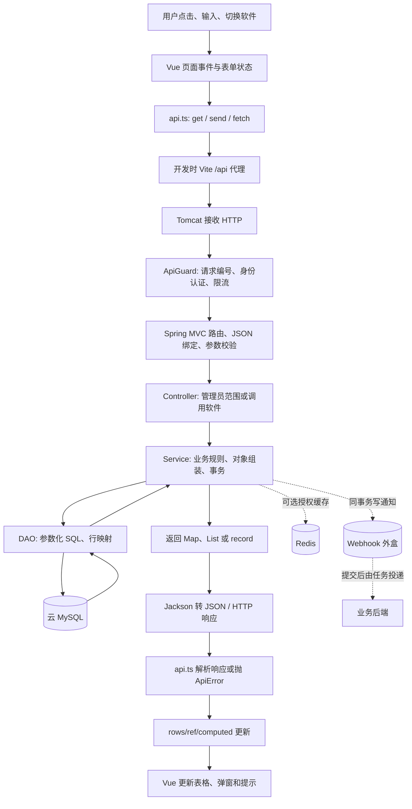
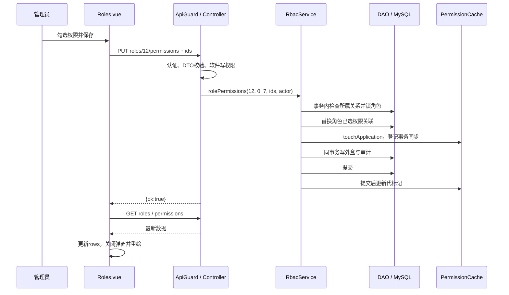

# MelonHub 项目讲解与数据链路

更新日期：2026-10-22。依据当前源码、Flyway V7、[数据库设计](数据库设计.md)及[验证记录](验证记录.md)编写。本文面向项目讲解与答辩；类、接口与算法的进一步说明见[详细设计](详细设计.md)。

## 1. 先用一分钟介绍项目

MelonHub 是企业内部统一权限平台。多个业务软件把角色、权限、用户授权配置集中到这里，在执行受保护操作前，通过 API 查询用户是否具有指定权限。业务软件继续负责自己的登录和业务数据，MelonHub 负责授权判断及授权治理，不承担 OAuth、OIDC、统一身份提供者或 SSO。

当前采用 RBAC0：用户通过角色获得权限；软件分别拥有角色和权限定义，角色可以共享同一条权限。角色编码、权限编码分别在软件内唯一。一个用户可以拥有多个软件的多个角色。部门只管理成员、筛选人员和组织批量授权，不决定用户的权限，用户没有部门也能申请、获批和校验权限。

工程采用前后端分离的分层单体：Vue 3 控制台调用 Spring Boot HTTP API，Controller 接收请求，Service 执行业务规则和事务，DAO 使用 Spring JDBC 访问云 MySQL。可选 Redis 缓存授权结果并提供跨实例限流，Java SDK 帮业务后端完成在线校验。控制台保存成功后重新读取数据，由 Vue 响应式机制更新页面。

答辩时可以直接说：**本项目解决“多个软件授权配置分散、授权变化难以及时生效、权限缺少到期和追溯机制”的问题，采用软件隔离的 RBAC、分层架构、数据库事务、可失效缓存和事务外盒来实现。**

## 2. 需求是什么，原来存在什么问题

| 实际需求 | 原始问题或风险 | 本项目对应设计 | 仍需注意 |
| --- | --- | --- | --- |
| 20 多个业务软件统一管理权限 | 每个软件各自维护授权，规则和管理流程重复 | 软件独立角色、业务 API、Java SDK | 接入软件要建立一致的权限编码含义 |
| 按岗位批量授权 | 逐人逐权限设置容易遗漏，维护成本高 | 用户多角色、角色权限集合、跨页选人和批量追加 | 不支持角色继承、通配权限和 ABAC |
| 人员调部门后仍保留业务职责 | 把部门当授权边界会造成非预期回收 | 部门关系与软件角色分离 | 管理员需要单独检查不再需要的角色 |
| 业务软件之间隔离 | 传入他软件的角色、权限或 token 可能越权 | API Key 固定软件、服务层所属校验、复合外键 | API Key 需要由业务后端保管 |
| 临时权限自动失效 | 忘记回收临时权限形成长期过度授权 | expires_at、校验时过滤到期、定时清理 | 到期判断不能只依赖每分钟清理任务 |
| 管理员操作可控可追溯 | 管理员权限过大，改动难以定位责任人 | 四类管理员、MFA、审计详情和哈希链 | 同库哈希链不能抵御掌握整库的攻击者重写全部证据 |
| 频繁校验时保护数据库 | 每次多表查询增加延迟和数据库负载 | 可选 Redis 缓存、限流、连接池和快速失败 | 当前默认关闭 Redis，不能据此宣称当前缓存性能 |
| 授权修改能正确生效 | 普通 TTL 缓存可能继续返回旧权限 | 代标记、busy、epoch 与到期时间限制 | Redis 部分网络故障存在已知一致性窗口 |
| 业务侧感知授权变化 | 数据库提交后直接发 HTTP，失败可能漏通知 | 同事务外盒、异步投递、签名、租约和重试 | 接收方需按事件 ID 去重，通知可能重复 |
| 操作页面立即反映结果 | 保存成功但列表仍显示旧数据；旧请求覆盖新结果 | 保存后重查、响应式赋值、请求序号 | 不等于服务器主动推送所有其他人的改动 |

## 3. 看懂 DTO、DAO、VO、Mapper 后再看链路

### 3.1 术语和当前实现的对应关系

| 术语 | 作用 | 当前项目真实实现 |
| --- | --- | --- |
| DTO，数据传输对象 | 描述一项跨边界传输的数据，约束输入或输出 | 后端输入主要为 `Requests` 中的 Java record；SDK 的 dto 包描述响应 |
| DAO，数据访问对象 | 把 SQL、参数绑定、结果读取封装起来 | `RbacDao`、`ContextDao`、`AuthDao`、`GovernanceDao`、`WebhookDao`、`AuditDao` |
| VO，本文指 View Object | 向调用方展示的结果结构 | 后端大多用 `Map<String,Object>`、列表和内部 record 组成视图，没有统一的 `vo` 包；SDK 有 `ContextView` 等类型 |
| PO/Entity，持久化实体 | 逐字段表达数据库记录 | 没有一套统一 ORM 实体层，DAO 使用 Map 或 `AccountRow`、`ContextRow` 等局部 record |
| Mapper，数据库行映射 | 将 ResultSet 的列转成 Java 数据 | `JdbcTemplate.queryForList` 默认行映射、`query(..., (rs,i) -> ...)` 行映射 lambda |
| Mapper，对象转换 | 将内部状态转换成接口结构 | `RbacService.attach/page`、`ContextService.view`、`AuthService.view` 等手工组装方法 |
| ObjectMapper | 在 Java 对象和 JSON 之间序列化、反序列化 | Jackson，Spring MVC 响应转换、缓存 JSON、Webhook 负载、SDK 解析都会使用 |
| TypeScript interface | 帮前端编译器检查对象结构 | `types.ts` 的 `Role`、`Permission` 等；不是运行时校验器 |

**不能把本项目讲成 MyBatis 的 Controller → Service → Mapper XML → Entity。** 当前没有 MyBatis Mapper 接口、Mapper XML 或 MapStruct 转换层。这里的 DAO 使用 Spring JDBC；Jackson 的 `ObjectMapper` 也不是数据库 Mapper。

DAO 是“负责访问数据的对象”，DTO/VO 是“被传递的数据结构”，两者不是同一种概念。DTO/VO 命名也不要求每个项目必须拥有独立包；要解释真实职责，而不是强行给现有代码补不存在的层。

### 3.2 同一个字段如何经过各层

以角色列表的创建时间为例：

```text
MySQL roles.created_at
  → DAO SQL 的 created_at AS createdAt
  → JDBC Map 中的 createdAt 键
  → Jackson 输出 JSON 的 createdAt 属性
  → api.ts 的 response.json() 得到 JS 对象
  → Role.createdAt 的 TypeScript 类型约定
  → 表格列 dataIndex="createdAt" / fmt() 格式化
  → 用户看到的时间
```

SQL 别名解决数据库下划线命名与前端驼峰命名的衔接；JDBC 负责列值类型转换，Jackson 负责 JSON 表达。`get<Role[]>()` 的泛型只是编译期约定，不会自动修复服务端字段名或验证响应内容。

### 3.3 两种真实的行映射写法

第一种是Map映射，以下摘自 `RbacDao.roles()` 的查询结构并省略统计列：

```java
return db.queryForList(
    "SELECT r.id,r.name,r.code,r.created_at AS createdAt "
        + "FROM roles r WHERE r.application_id=? ORDER BY r.id", app);
```

`?` 是绑定参数，不是把软件ID直接拼到SQL。结果是一行一个Map，Service可以再附加 `permissionIds`；缺点是 `item.get("createdAt")` 的拼写不由Java类型系统保证。

第二种是显式映射为record，`ContextDao.state()` 的映射函数如下：

```java
(rs, i) -> new ContextState(
    new ContextRow(rs.getLong(1), rs.getLong(2), rs.getLong(3),
        rs.getLong(4), rs.getTimestamp(5).toInstant()),
    rs.getBoolean(6))
```

它按SELECT列顺序读取值，转为带类型的记录。`rs` 是ResultSet，`i` 是当前行序号；这是实现RowMapper职责的lambda，不需要独立的Mapper接口文件。列顺序或可空字段变化时仍需同步检查映射。

## 4. 整体数据链路



开发时浏览器访问 5174，`vite.config.ts` 把 `/api` 代理到本机 8080。生产环境如何提供静态页面、HTTPS 和反向代理，需要另行部署配置；Vite 开发代理不是生产网关。

### 4.1 进入控制台前的登录链路

`LoginView.vue` 提交用户名密码 → `POST /api/auth/login` → ApiGuard按来源限流 → `Requests.Login`绑定与校验 → `AuthController.login` → `AuthService.login` → `AuthDao.account`查询账号认证快照。Service验证锁定、BCrypt密码及账号启用；需要MFA但未提交口令时返回 `MFA_REQUIRED`，前端进入口令步骤并再次提交。

验证成功后，DAO通过带凭据版本、密码哈希和MFA快照条件的INSERT创建会话。平台只存token哈希，返回原文token和公开管理员信息；前端存入sessionStorage，后续请求添加Bearer。控制台初始化还会读取当前身份与部门/软件列表，Pinia保存供页面和抽屉使用的数据。

登录请求本身公开，只表示无需已有会话，不表示无需验证密码。管理员会话和业务软件上下文是两套不同对象，不能拿控制台token替代X-API-Key。

### 4.2 失败响应如何走回页面

DTO绑定失败、业务异常或数据库异常 → `ApiErrors`映射HTTP状态与 `{code,message,requestId}` → `api.ts`抛 `ApiError` → `attempt`或页面catch显示提示并结束loading。过滤器在进入MVC前拒绝的请求，由ApiGuard调用同一错误体构造方法直接输出。异常传播到事务代理时触发相应回滚；前端提示失败不等于可以撤销已经在服务端提交、但响应丢失的请求。

这条错误链与成功链同样重要：它让界面无需识别SQL异常，也避免向浏览器暴露数据库原始错误或敏感认证数据。

## 5. 链路一：打开角色列表，系统如何寻找数据和返回对象

源码入口：[Roles.vue](../frontend/src/pages/Roles.vue)、[api.ts](../frontend/src/api.ts)、[AdminController](../backend/src/main/java/com/melonhub/rbac/controller/AdminController.java)、[RbacService](../backend/src/main/java/com/melonhub/rbac/service/RbacService.java)、[RbacDao](../backend/src/main/java/com/melonhub/rbac/dao/RbacDao.java)。

### 5.1 发起请求

1. `Roles.vue` 调用 `useAuthorizationScope()`，取得当前软件及可选部门筛选；抽屉中使用局部范围，独立页面回退到 Pinia 的范围。
2. `watch(() => scope.domainKey, ..., { immediate:true })` 在进入页面或范围变化时触发 `reload()`。
3. `roles.load()` 调用 `get<Role[]>('/admin/roles', scope.domainQuery)`。
4. `qs()` 使用 `URLSearchParams` 编码查询参数，`api()` 拼接 `/api` 并添加当前管理员的 `Authorization: Bearer ...`。

请求形状如下，ID 仅作教学示例：

```http
GET /api/admin/roles?departmentId=0&applicationId=7
Accept: application/json
Authorization: Bearer <管理员会话占位符>
```

### 5.2 获取请求和检查调用方

1. Tomcat 接收请求，`ApiGuard` 在 Controller 之前执行。
2. 过滤器校验规范路径，设置请求编号、安全头，把管理员认证结果放到 request 属性。
3. Spring MVC 的 `DispatcherServlet` 根据 HTTP 方法和路径找到 `AdminController.roles()`。
4. `@RequestParam` 把字符串参数转成 long。方法调用 `AdminAccess.readApplication(req, applicationId)`，确认管理员可以读取该软件。
5. 身份认证回答“你是谁”，软件范围检查回答“你能读哪个软件”；两次检查目的不同。

### 5.3 处理规则、查库和映射

1. Controller 调用 `RbacService.roles(dept, app)`；`domain()` 确认软件存在，非零部门参数还会检查部门是否存在，但不检查部门准入或成员资格。
2. `RbacDao.roles()` 查询该软件的角色。当前 SQL 以 `application_id` 作为角色隔离条件，部门不再拥有一份独立角色。
3. JDBC 从连接池取得连接，绑定 SQL 参数，MySQL 执行查询，`queryForList` 将每行映射为 `Map<String,Object>`。
4. Service 再读取角色与选中权限的关联，通过 `attach()` 给角色追加 `permissionIds`。这是结果组装，不是额外的一张数据库表。
5. 使用集合查询后在内存附加关联信息，避免为列表中的每个角色单独发一次查询。

DAO 返回数据 → Service 丰富结果 → Controller 返回对象。Controller 方法声明 `Object` 不代表 HTTP 原样返回 Java 内存对象；Spring MVC 仍然会通过消息转换器序列化为 JSON。

### 5.4 返回对象并更新页面

示意响应只展示核心字段：

```json
[
  {"id":12,"name":"阅读者","code":"reader","enabled":true,"permissionIds":[31],"memberCount":2}
]
```

1. Jackson 将 List、Map 和值转换成 JSON，HTTP 状态表示请求是否成功。
2. `api.ts` 执行 `response.json()`，成功时返回解析结果。
3. `useList` 确认当前响应的请求序号仍是最新，再赋值 `rows.value = result`。
4. `computed rows` 根据搜索和状态过滤源列表，Vue 追踪依赖并更新 Ant Design Vue 表格。

因此页面数据不是模板直接读取 MySQL，而是经过 HTTP、业务规则、数据访问和序列化后，进入前端响应式状态。

## 6. 链路二：保存角色权限，事务和页面刷新怎样串起来

这里选择已有角色保存权限子集作为完整写链路。软件拥有权限定义，`role_permissions` 表示各角色勾选的集合，同一条权限可以被多个角色引用；创建定义与勾选授权是两步。



### 6.1 输入不是直接操作数据库表

`Roles.vue.saveGrant()` 从勾选值生成 `{ ids:[31,32] }`，通过 `send('PUT', ...)` 序列化为 JSON。Spring 将其绑定到 `Requests.Ids`：集合不能为空引用、最多 1000 项，每项必须是正整数且不能是 null；空数组合法，表示清空已选权限。

DTO 只检查数据形状。它无法知道权限 31 与角色 12 是否同属软件 7，这些必须由 Service 查询并判断。

### 6.2 Service 是业务规则和事务边界

`RbacService.rolePermissions()` 的实际顺序：

1. `scoped("roles", ...)` 验证角色属于该软件。
2. `LinkedHashSet` 对传入权限 ID 去重。
3. `dao.lockRole(role)` 对角色加行锁，串行化同角色的配置变更。
4. `scopedCount("permissions", ...)` 确认所有权限都属于当前软件，允许软件内角色共享，拒绝跨软件关联。
5. 查询旧关联并调用 `replaceRolePermissions()` 更新集合。
6. `cache.touchApplication(app)` 登记软件相关缓存失效。
7. `webhooks.emit()` 写 `role.permissions.changed` 外盒，`audit()` 记录操作人与差异。
8. Spring 事务代理提交后才回到 Controller 的正常返回；中间异常导致事务回滚。

数据库复合外键再验证角色与权限属于同一软件，形成应用规则和存储约束两道检查。数据库事务只覆盖同一数据源的写入；Redis 与外部 HTTP 不是 MySQL 本地事务的一部分。

### 6.3 为什么不是保存后直接修改表格中的一个数字

角色的权限数、权限 ID、关联统计可能一起变化。页面采用保存后重新加载列表，让数据库结果成为页面依据；`attempt()` 统一 busy 状态和成功/错误提示，失败则保留编辑入口。这样实现简单，但会多一次读取，页面也不会自动知道其他管理员稍后做出的修改。

## 7. 链路三：分配用户角色与有效期限

源码：[UserRolesForm.vue](../frontend/src/components/UserRolesForm.vue)、[BatchRolesModal.vue](../frontend/src/components/BatchRolesModal.vue)、`RbacService.userRoles/addUserRoles`。

### 7.1 单人编辑是“替换完整集合”

`PUT /api/admin/users/{id}/roles?applicationId=7&departmentId=0` 使用 `Requests.UserRoles`。`ids` 是用户在该软件保留的完整角色集合，不是仅本次新增的角色。

```json
{
  "ids":[12,13],
  "expiries":[{"roleId":12,"expiresAt":"2026-12-01T18:00:00+08:00"}]
}
```

期限优先级是：逐角色 `expiries` → 统一 `expiresInDays` → 保留已有期限；新角色若两者都未指定则永久。显式 `expiresAt:null` 表示永久。移出 `ids` 的角色会被撤销。

Service 锁用户，验证软件范围，读取锁定的分配记录，计算删除、新增和期限变化。重新授予或更改期限时生成新 `grant_id`，随后撤销该用户在该软件的上下文，触发缓存失效，写通知与审计。其他软件不受该次角色集合替换影响。

表单会回传所选定时角色的期限，拒绝已经过去的到期时间，避免用户打开页面后角色自然过期，保存旧表单时意外把该角色变成永久授权。

### 7.2 批量设置是“追加”

`POST /api/admin/assignments/batch` 使用 `Requests.BatchUserRoles`。批量追加保留所有已有有效角色与期限；只补充缺失或已过期的所选角色。部门大于 0 时验证选中用户仍属于该部门，部门为 0 时面向全部用户。

多软件批量授权由前端逐软件调用接口，每个软件独立提交。某软件失败时，已成功的软件保留，前端显示成功结果及待处理软件。它不是一次跨软件整体回滚的事务。

## 8. 链路四：业务系统如何真正判断权限

源码：[BusinessController](../backend/src/main/java/com/melonhub/rbac/controller/BusinessController.java)、[ContextService](../backend/src/main/java/com/melonhub/rbac/service/ContextService.java)、[ContextDao](../backend/src/main/java/com/melonhub/rbac/dao/ContextDao.java)。

### 8.1 先分清三类身份凭据

| 凭据 | 表达什么 | 放在哪里 |
| --- | --- | --- |
| 管理员会话 Bearer token | 哪个管理员在操作控制台 | 控制台 sessionStorage；数据库保存哈希 |
| X-API-Key | 哪个业务软件调用平台 | 业务后端；数据库保存哈希 |
| X-Context-Token | 该软件中哪个用户激活了哪些角色 | 业务后端/SDK；数据库保存哈希 |

API Key 不能证明终端用户本人是谁。业务软件必须先完成自身登录认证，再从可信会话取得 `externalId`；不能把浏览器随意填入的用户标识直接当成认证结果。

### 8.2 创建上下文

业务后端发送：

```http
POST /api/v1/contexts
X-API-Key: <软件密钥占位符>
Content-Type: application/json

{"externalId":"employee-demo","activeRoleIds":[12]}
```

`ApiGuard` 验证密钥，并将软件 ID 写入 `ApplicationCaller`；业务 Controller 从该对象取软件，而不是相信调用方任意提交的软件 ID。`ContextService.issue()` 在事务内：

1. 通过 externalId 锁用户，验证用户及软件启用。
2. 查询该软件已分配、启用、未到期角色。
3. 验证激活角色是上述集合的子集；省略/null 表示全部，空数组表示一个也不激活。
4. 清理旧版本或已过期上下文，生成随机 token，数据库只存 SHA-256。
5. 写 `permission_contexts` 和 `context_roles`，计算初始权限视图，写审计。
6. 缓存元数据只在事务提交后写入，响应包含首次发放的原文 token 和当前角色权限。

上下文有效期一小时。`departmentId`、`switchDepartment` 是兼容字段，不再切换全局部门，不要求用户属于某部门；部分旧方法名和注释仍保留历史叫法，应以当前 SQL 和规则为准。

### 8.3 在线校验

```http
POST /api/v1/contexts/check
X-API-Key: <软件密钥占位符>
X-Context-Token: <上下文占位符>
Content-Type: application/json

{"permissions":["item:read","item:export"]}
```

`ContextService.check()` 通过 `resolve()` 取得有效上下文及权限集合。缓存可用时读取 Redis，否则在 `TransactionTemplate` 中查询数据库状态与角色权限；校验读路径不使用 `FOR UPDATE`。

```text
有效角色 = 此软件的已分配角色 ∩ 上下文激活角色 ∩ 启用且未到期角色
有效权限 = 有效角色中已选权限的 code 并集
单项决定 = 请求 code 是否精确存在于有效权限集合
allowed = 所有请求权限均为 true
```

MySQL 查询联接 `permissions → role_permissions → roles → context_roles → user_roles`，使用 `DISTINCT p.code` 去重。`resource/action` 是元数据，不参与“模糊匹配”；`item:*` 没有通配含义，不同大小写视为不同编码。

```json
{"allowed":false,"decisions":{"item:read":true,"item:export":false},"contextVersion":0}
```

上下文失效返回 `401 CONTEXT_INVALID`，不是正常权限不足的 `allowed:false`。Java SDK 可清理旧上下文并重建一次，但重建不会重新授予已撤销的角色。

### 8.4 不能把上下文理解成永久权限快照

上下文固定的是用户、软件和激活角色选择等元信息。每次有效权限解析仍考虑角色启停、权限关联和分配期限。角色权限变化在后续校验中生效；用户角色重新分配等操作还会撤销软件上下文。

到期时不必等清理任务：SQL 过滤 `expires_at`，缓存 TTL 同时受最早角色到期时刻限制，并在命中时检查 `refreshAt`。后台清理是删除旧记录和发送通知，不是到期生效的唯一来源。

## 9. 链路五：异步通知、复核与审计

### 9.1 Webhook 不在数据库事务中等待网络

授权事务将变更与外盒记录一起提交。`WebhookService` 每 5 秒调度，认领待发送记录，再交给发送线程；默认并发 4、每批上限 20，HTTP 超时 5 秒，不跟随重定向。

`WebhookDao.claim()` 通过状态、到期时间和原 `attempts` 条件更新，避免多实例同时认领。结果写回也带本次 attempt；租约过期后旧线程不能覆盖新的投递结果。最多 8 次，失败退避 `min(60,2^(n-1))` 分钟；最后一次租约过期进入 FAILED。保留期清理只删除 DELIVERED/FAILED。

签名使用 HMAC-SHA256。接收方先验签、校验时间容差，再按事件 ID 去重，最后清理 SDK 上下文缓存或更新自己的数据。外盒提供可重试投递，不能声称网络上的严格“恰好一次”。

### 9.2 复核保护的是某一次授予

创建复核时保存授权快照和 `grant_id`。管理员选择 REVOKE，关闭复核时只删除 grant_id 仍相同的分配。如果期间角色被重新授予或续期，新 grant_id 与快照不同，条目标记 skipped，避免旧复核误撤销新授权。未决定的条目关闭时保留。

### 9.3 审计写入和哈希封存是两段链路

业务事务先写普通 `audit_events`，`AuditSealService` 后台按封存序号连成哈希链。封存按实际可见记录顺序分配 `seal_seq`，避免把自增 ID 当作并发事务的提交顺序。保留期删除链前缀时更新锚点，校验接口分页返回 `complete/nextSeq` 与第一处问题。

链能发现部分记录被修改、缺失或链路断裂，但封存存在调度延迟，且链与数据在同一个数据库，不能作为独立第三方存证。

## 10. 页面“热更新”究竟是哪一种更新

| 现象 | 实现 | 是否访问后端 | 当前边界 |
| --- | --- | --- | --- |
| 输入关键词后表格变化 | `ref/reactive` 与 `computed` 重新计算；部分页面服务端查询 | 取决于页面 | 本地过滤不等于数据库改变 |
| 保存成功后表格更新 | `send` 完成后调用 `load/reload`，更新 rows | 是 | 以重新查询结果为准 |
| 切换软件后列表更新 | `watch(domainKey)` 发新请求 | 是 | 旧响应不能覆盖新范围 |
| 子抽屉完成后父列表更新 | 子组件 emit，父组件监听后重载 | 通常是 | 每个组件按自身事件实现 |
| 修改 `.vue` 后开发页面变化 | Vite + Vue 插件提供 HMR | 访问开发服务器 | 只针对开发源代码，不是业务数据同步 |
| 其他管理员修改后本页同步 | 当前无通用 WebSocket/SSE 订阅链路 | 需重新加载或页面自身定时查询 | Webhook 面向业务后端，不是控制台全局推送 |

HMR 只能描述前端开发体验。修改 Java 后端源码需要重新构建/启动相应程序；不能把 Vite 的页面热替换讲成后端业务类自动热部署。

### 10.1 为什么需要请求序号

用户先选软件 A 再选 B。A 的慢响应晚于 B 到达，如果无保护，A 数据会覆盖 B 页面。`useList/usePaged` 每次 load 自增 sequence，只接收最新序号；clear 也会使旧请求作废。它是丢弃过时结果，不代表取消已经发送到服务器的请求或回滚服务器处理。

`GlobalSearch`、`UserPicker` 另有搜索防抖及查询变化立即作废逻辑。会话也做类似判断：旧 token 的迟到 401 只有在它仍是当前 token 时才清理会话，避免用户重新登录后被旧请求退出。

## 11. 老师常问：采用什么设计方法，为什么

下表是从实现归纳出的工程方法，不能据此声称使用了未出现的设计框架。

| 方法 | 源码落点 | 采用理由 | 代价与取舍 |
| --- | --- | --- | --- |
| 需求驱动的 RBAC 建模 | 软件、角色、角色权限、用户角色关系 | 岗位授权可复用，软件隔离，避免逐人授权 | 复杂条件授权不在 RBAC0 范围 |
| 分层与关注点分离 | Controller / Service / DAO | HTTP、规则、SQL 可分别维护测试 | 仍需管理大 Service/DAO 的规模 |
| 模块化单体 | controller、service、security、cache 等包 | 共享数据库事务，部署和调试成本较低 | 不能单独扩容某个内部服务模块 |
| 构造器依赖注入、IoC | Service 构造器接收 DAO 等 | 依赖明确，方便测试替换，统一交由容器管理 | 并非每个类都额外建立接口 |
| DTO 和多层校验 | Requests、@Valid、Service、外键 | 输入形状、业务所属关系、存储完整性分开保证 | 校验规则要同步维护 |
| 显式 SQL 和 JDBC 行映射 | 六个 DAO | 多表授权查询、锁和条件更新可直接审查 | Map 字段不受编译期强校验 |
| 事务脚本式业务服务 | userRoles、approve、closeReview | 一项用例的规则和提交范围集中可读 | 复杂度增加后需按用例继续拆分 |
| 行锁及条件更新 | 用户锁、角色锁、grant_id、attempts | 防止并发覆盖、错回收、旧投递覆盖新结果 | 锁会争用，必须限制持有时间 |
| Cache-Aside 思路加事务失效协议 | ContextService、PermissionCache | 重复读提速，同时处理旧快照回填问题 | Redis 增加一致性和故障恢复复杂度 |
| 事务外盒 | WebhookService、WebhookDao | 数据提交和待通知记录一致，不把网络放进事务 | 接收方幂等、重试和失败处理仍必需 |
| 门面、构建器及拦截器 | Authorizer、Client.Builder、权限拦截器 | 降低业务软件接入成本，集中授权检查 | 身份头必须来自可信认证链路 |
| 前端组合式复用与状态分区 | composables、Pinia、provide/inject | 共用加载逻辑，抽屉配置不改动外层选择 | 需主动处理异步响应与组件生命周期 |

## 12. 答辩问答

### 12.1 “这个设计的需求是什么，存在什么问题？”

需求是统一多个软件的授权管理与在线判断，同时保留临时授权、审批、复核和审计。问题来自权限配置重复、部门变更误伤授权、跨软件越权、授权过期不及时、缓存脏读和外部通知失败。我的设计分别用软件角色模型、组织关系解耦、API Key 与复合外键、到期过滤、缓存失效协议和事务外盒解决；剩余边界包括服务器 Redis 尚未验证、无高可用完整方案及审计未外部存证。

### 12.2 “为什么不把部门放在角色主键或唯一键里？”

当前需求明确角色归软件，部门只组织成员。按部门复制角色会产生同软件角色多份配置，人员转部门又可能丢授权。因此 V6 把角色唯一约束改为软件内唯一，把部门从角色和权限定义中移除，用户角色上的部门只记录来源。

### 12.3 “为什么权限归软件，还要 role_permissions？”

`permissions.application_id` 表示权限定义所属软件，`role_permissions` 表示各角色勾选的权限集合。多个角色可以引用同一条权限，修改共享定义会同时影响这些角色；移除某个角色的关联不影响其他角色。V7 已移除 `permissions.role_id`，复合外键保证角色与权限属于同一软件。

### 12.4 “为什么 Controller 不直接调用 JDBC？”

Controller 负责 HTTP 和操作范围，Service 负责业务规则与事务，DAO 负责 SQL。若混在 Controller，审批、SDK 接口和控制台会重复规则，审计、缓存失效也更容易遗漏。

### 12.5 “为什么没用 MyBatis，也没有专门 VO？”

当前用 Spring JDBC 显式控制复杂查询、锁和条件更新，Map/record 直接构造响应，减少 ORM 配置和转换代码。代价是字段名、数字转换和响应契约较依赖测试。后续可针对稳定响应逐步增加强类型 VO，不需要为了术语完整添加空 Mapper 层。

### 12.6 “用了面向对象，是不是所有类都符合单一职责？”

职责已按边界划分，但不能说完全做到。`RbacService/RbacDao` 覆盖多个配置用例，体积较大，是实际维护压力点。现阶段优先保持规则与事务可追踪，未来可按用户、软件、角色等用例拆分，避免只为层数而拆类。

### 12.7 “前端禁用按钮已经做权限了，为什么后端还要检查？”

前端只改善操作体验，请求可以绕过页面直接发送。真正的边界是过滤器认证、Controller 范围授权、Service 所属规则和数据库约束；只隐藏按钮无法保证安全。

### 12.8 “缓存为什么不简单删键？”

如果读请求已读到旧快照，写事务删键并提交后，这个读请求仍可能把旧值写回。代标记使旧请求只能写旧代键，提交后读者使用新代键；busy 阻止写事务期间回填，epoch 处理遗漏失效后的恢复。

### 12.9 “能保证所有故障下强一致吗？”

不能一概保证。正常数据库与缓存协议下，变更提交后开始的校验应看到新状态，并发重叠请求可能返回旧结果。写实例无法访问 Redis 而其他实例仍可访问的部分故障下，其他实例可能在 epoch 推进前读取旧缓存，最长受 60 秒 TTL 限制。当前 Redis 默认关闭，不涉及运行中的 Redis 命中链路。

### 12.10 “分配到期后要过一分钟才撤权吗？”

不用等待。权限查询直接检查 expires_at，缓存期限不超过最早到期时刻；每分钟任务只负责清除到期记录与通知审计。

### 12.11 “grant_id 和 user_id/role_id 有什么区别？”

用户与角色确定哪条关系，grant_id 确定该关系的哪一次授予。相同用户和角色可以撤销后再授予，旧复核不能仅凭相同 ID 删除后来产生的新分配。

### 12.12 “Webhook 失败会导致授权回滚吗？”

外部发送发生在授权事务提交后，失败会重试投递，不回滚已提交授权。同事务写外盒解决漏记待通知事项；接收方处理重复事件仍需幂等。

### 12.13 “SDK 缓存了权限，会不会一直放行？”

`MelonHubAuthorizer` 缓存的是上下文 token，每次 `hasPermission` 仍在线调用平台 check。平台不可达或 5xx 时拒绝放行；4xx 业务错误可能抛异常，由业务入口/拦截器处理。不能把它描述成离线缓存永久允许结果。

### 12.14 “为什么不用微服务？”

当前多个模块共享授权数据库，审批、分配、审计和外盒需要本地事务。单体便于开发、部署和定位问题，先把隔离、正确性和治理做好。20 多个接入软件不等于平台内部必须拆成20多个服务。

### 12.15 “这套系统现在有什么不足？”

稳定响应缺少统一强类型 VO；核心 Service/DAO 规模较大；Redis 脚本面向单节点，服务器 Redis 尚未部署验证；没有通用控制台实时推送；审计链没有外部存证；Webhook/TOTP 密钥仍以原文保存在数据库；SDK 身份头依赖业务认证链路；审批尚无负责人路由、多级审批等。完整边界见详细设计，不能把规划写成已完成。

## 13. 推荐讲解顺序和定位清单

1. 先讲需求和“软件分别拥有角色与权限，角色与权限多对多；用户 → 角色”，说明部门只管理成员。
2. 打开 `Roles.vue → api.ts → ApiGuard → AdminController → RbacService → RbacDao`，演示一个列表读取。
3. 展示 `Requests.Ids → rolePermissions → replaceRolePermissions`，讲输入校验、业务规则、事务、缓存与审计。
4. 展示 `BusinessController → ContextService.check/resolve/compute → ContextDao.effectivePermissions`，讲真正的权限计算。
5. 回到 `composables.ts` 解释页面刷新、旧响应保护和 HMR 区别。
6. 最后补充外盒、grant_id 和现阶段限制，再回答“为何这么设计”。

源码根目录：[后端](../backend/src/main/java/com/melonhub/rbac)、[前端](../frontend/src)、[Java SDK](../sdk/java/src/main/java/com/melonhub/client)。数据库字段、迁移和完整接口分别查阅[数据库设计](数据库设计.md)与[API](API.md)。本文是源码讲解，不表示本次重新执行了运行验收。
